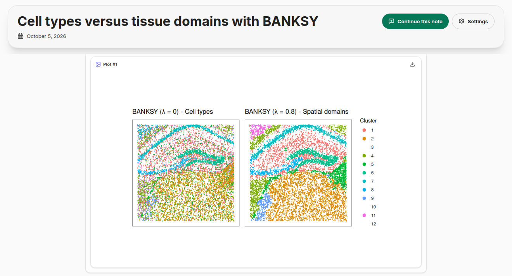

<div align="center">
  <h1>OmicsBase</h1>
  <p><strong>Analyse omics data in R with an AI assistant, and keep every step reproducible.</strong></p>
  <p>
    <a href="https://omicsbase.utu.fi">Open OmicsBase</a> ·
    <a href="#example-notes">Examples</a> ·
    <a href="docs/SETUP.md">Developer setup</a> ·
    <a href="docs/DEPLOYMENT.md">Deployment</a> ·
    <a href="https://github.com/0xMuluh/omicsbase/issues">Issues</a>
  </p>
</div>

<p align="center">
  
</p>

OmicsBase is a workspace for microbiome, single-cell, spatial transcriptomics and mass spectrometry analysis with Bioconductor. You ask a question in a **note**; the assistant writes R code, runs it, and keeps the code, output and figures together in your project, so anyone can see exactly how a result was produced. For longer work, **Reports** hands the project to an agent that writes and renders a Quarto report.

| | |
| --- | --- |
| **Notes that run R** | Each answer can contain R cells that run on the server, with Bioconductor, mia and related packages installed. Code, output and plots stay in the note. |
| **Grounded in the books** | The assistant searches *Orchestrating Microbiome Analysis*, *Orchestrating Single-Cell Analysis*, *Orchestrating Spatial Transcriptomics Analysis*, *R for Mass Spectrometry* and *Metabonaut*, and reads R help pages before answering. |
| **Public data** | Notes load data from curatedMetagenomicData, Bioconductor data packages, MGnify and Zenodo. |
| **Reports** | An OpenHands agent works on the project files and builds a Quarto report site. |
| **Share and continue** | Share a note as a public link; others can read it without an account and continue it in their own workspace. |
| **Choose the model** | Pick from several hosted models for each note. |

## Example notes

Over 300 example notes are public. A few:

- [Cell types versus tissue domains with BANKSY](https://omicsbase.utu.fi/share/2ST5k-dbtSjCisr-XhIeX) (spatial)
- [Cell classes across slices of the hypothalamus](https://omicsbase.utu.fi/share/hJYFU7EbAvFR2pINPOefN) (spatial)
- [How many false positives? Differential abundance with no real difference](https://omicsbase.utu.fi/share/Sq0r_YiM7dLT_T8uTRrTW) (microbiome)
- [Seasons in the Hadza gut](https://omicsbase.utu.fi/share/fr7JQZRjzcaH9wvCO1gEe) (microbiome)
- [Quality control with spike-ins in 416B cells](https://omicsbase.utu.fi/share/INn_qf2cAft-0pzA2ujGy) (single-cell)
- [Reporter ions in a TMT11 MS3 run](https://omicsbase.utu.fi/share/EO_LG89UzF_5c-nPTXI8J) (proteomics)

## Getting started

**Use it**: open <https://omicsbase.utu.fi> and sign in with your University of Turku account or Google.

**Run your own instance**: OmicsBase is a developer setup, not a packaged release. You need Git, Python 3.12+, Docker with Compose, Node.js 24 and your own model-provider keys.

```bash
git clone --recurse-submodules https://github.com/0xMuluh/omicsbase.git
```

Then follow [docs/SETUP.md](docs/SETUP.md) to build the images, configure `librechat/.env` and set up the [knowledge library](knowledge/README.md).

## Repository

| Path | Contents |
| --- | --- |
| `engine/` | R execution, MCP tools and knowledge search |
| `librechat/` | Submodule: [0xMuluh/LibreChat](https://github.com/0xMuluh/LibreChat), the notes interface |
| `openhands/` | Submodule: [0xMuluh/OpenHands](https://github.com/0xMuluh/OpenHands), the Reports agent |
| `docker/` | Image recipes for the engine, its analysis base and Reports |
| `deployment/` | Compose override, `librechat.yaml`, Caddy, LUMI-K and Rahti manifests |
| `knowledge/` | Pinned book sources and attribution |
| `scripts/` | Image builds, runtime preparation, sitemap |
| `docs/` | Setup, deployment and maintenance records |

Each submodule pins one commit of its fork; [UPSTREAM.md](UPSTREAM.md) describes how upstream releases are merged.

## License

Original OmicsBase code is under the [MIT License](LICENSE). Third-party code keeps its own copyright and license; see [THIRD_PARTY_NOTICES.md](THIRD_PARTY_NOTICES.md). The book texts used by the knowledge search have their own terms; see [knowledge/ATTRIBUTION.md](knowledge/ATTRIBUTION.md).

OmicsBase is developed at the University of Turku ([datascience.utu.fi](https://datascience.utu.fi)).
