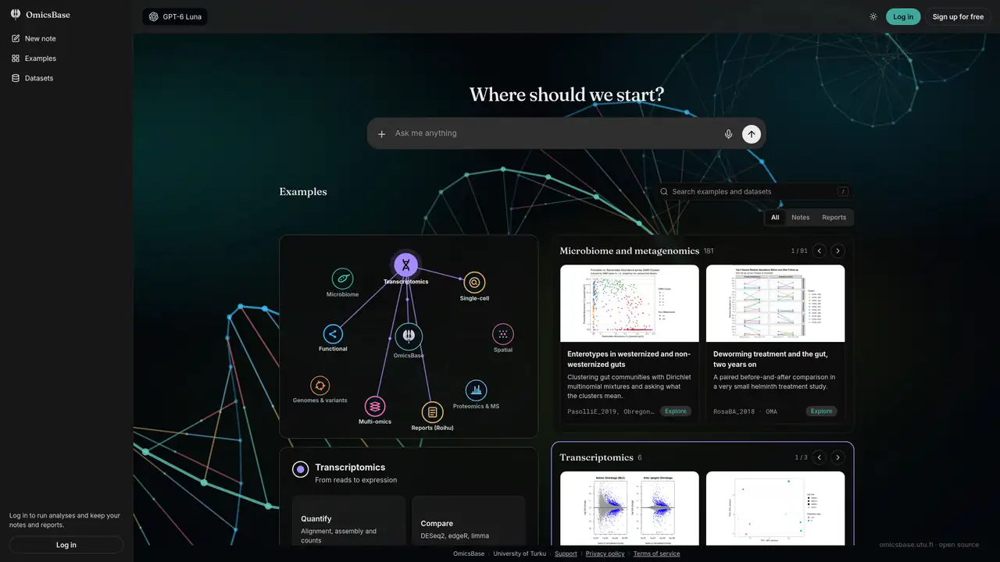

<h1 align="center">OmicsBase</h1>

<!-- Cover image to be designed: OmicsBase wordmark over a note with an R cell and its figure, and the Reports workspace beside it. -->

<h3 align="center">
  The open-source AI workspace for biological data analysis in R and Bioconductor.
</h3>

<p align="center">
  Notes that run your R. Your own analysis agent on a supercomputer.
</p>

<p align="center">
  <a href="https://omicsbase.utu.fi"></a>
  <a href="#examples"></a>
  <a href="https://bioconductor.org"></a>
  <a href="LICENSE"></a>
</p>

<p align="center">
  <a href="https://omicsbase.utu.fi">Open OmicsBase</a> ·
  <a href="#examples">Examples</a> ·
  <a href="#what-you-can-analyse">What you can analyse</a> ·
  <a href="#reports-on-roihu">Reports on Roihu</a> ·
  <a href="#on-your-own-machine">Run it yourself</a>
</p>

<p align="center">
  <picture>
    <source media="(prefers-color-scheme: light)" srcset="docs/images/omicsbase-film-light.webp">
    
  </picture>
</p>

<hr>

OmicsBase is an open-source AI workspace for omics analysis in R and Bioconductor. Ask a question in a **note** and get back R code that has already run, with its output and figures, ready to check, share or continue. For larger projects, **Reports** turns it into your own analysis team on the CSC Roihu supercomputer, taking raw data all the way to a finished report.

Use it at [omicsbase.utu.fi](https://omicsbase.utu.fi) with your University of Turku or Google account.

| | |
| --- | --- |
| [**🧪 Runs your R**](https://omicsbase.utu.fi/share/Sq0r_YiM7dLT_T8uTRrTW) | Code, output and figures stay together in the note |
| [**📚 Grounded in the books**](knowledge/README.md) | Searches the Bioconductor books and R help before it writes code |
| [**🦠 Every omics**](#what-you-can-analyse) | Microbiome, single-cell, spatial, bulk RNA-seq, proteomics, metabolomics |
| [**🗂️ Public data built in**](#examples) | curatedMetagenomicData, MGnify, Zenodo, Bioconductor data packages |
| [**🖥️ Raw data to report**](#reports-on-roihu) | QC, alignment and assembly with fastp, bowtie2, SPAdes and more, run by your own agent on the CSC Roihu supercomputer |
| [**✅ Checks your design first**](#what-you-can-analyse) | Matches samples to files and metadata, flags small groups and confounding before testing |
| [**🔗 Share and continue**](https://omicsbase.utu.fi/share/2ST5k-dbtSjCisr-XhIeX) | Anyone can open a note and continue it in their own workspace |
| [**🤖 Any model, any agent**](#reports-on-roihu) | Pick the model per note; OpenHands, Claude Code, Codex, Gemini, Pi or OpenCode in Reports |

## Examples

300+ public notes on published data, recorded as they ran.

| | |
| --- | --- |
| 🦠 **Microbiome** | [False positives under a null](https://omicsbase.utu.fi/share/Sq0r_YiM7dLT_T8uTRrTW) · [Seasons in the Hadza gut](https://omicsbase.utu.fi/share/fr7JQZRjzcaH9wvCO1gEe) |
| 🗺️ **Spatial** | [BANKSY domains](https://omicsbase.utu.fi/share/2ST5k-dbtSjCisr-XhIeX) · [Hypothalamus slices](https://omicsbase.utu.fi/share/hJYFU7EbAvFR2pINPOefN) |
| 🔬 **Single-cell** | [Spike-in QC in 416B cells](https://omicsbase.utu.fi/share/INn_qf2cAft-0pzA2ujGy) |
| ⚖️ **Proteomics** | [TMT11 reporter ions](https://omicsbase.utu.fi/share/EO_LG89UzF_5c-nPTXI8J) |

## What you can analyse

| | |
| --- | --- |
| 🦠 **Microbiome and metagenomics** | Import any format · diversity · ordination · differential abundance with MaAsLin3, ANCOM-BC2, ALDEx2 · networks · pathways · QC, host removal, profiling and assembly with fastp, bowtie2, Kraken 2, Bracken, MetaPhlAn and MEGAHIT in Reports on Roihu |
| 🧬 **Transcriptomics** | DESeq2, edgeR, limma · time courses · alignment, de novo assembly and quantification with STAR, HISAT2, minimap2, Trinity and Salmon in Reports on Roihu |
| 🔬 **Single-cell** | QC · integration · clustering · annotation · trajectories · velocity |
| 🗺️ **Spatial** | Visium, Slide-seq, seqFISH, CosMx · neighbourhoods · domains |
| ⚖️ **Proteomics and metabolomics** | Spectra · quantification · TMT · PCA, heatmaps, volcano plots · over-representation and GSEA |
| 🧪 **Functional annotation** | GO, KEGG and Reactome · enrichment and GSEA · community function · InterProScan and eggNOG-mapper in Reports on Roihu |
| 🧩 **Genomes and variants** | Multiple sequence alignment and phylogenetic trees with MAFFT and IQ-TREE 2 · assembly, mapping, gene finding, variant calling and GWAS with SPAdes, bwa, Prokka, GATK and PLINK in Reports on Roihu |
| 🔗 **Multi-omics** | Taxa with their enzymes · cross-omics networks · survival by subtype |
| 📄 **Reports** | Multi-page Quarto sites, PDF or Word · methods with references · findings and interpretation · every figure with its source table · `sessionInfo()` |

## Reports on Roihu

<!-- Screenshot to be taken: the report workspace with the Roihu session bar, the agent, the file tree and a rendered report. -->

| | |
| --- | --- |
| **🔒 Runs as you** | Your own job, in your own CSC project; nobody else sees your files |
| **⚡ Real compute** | Pick cores, memory and time, up to 36 hours |
| **🧰 Full toolbox** | R 4.6, Bioconductor 3.23 and Quarto, plus CSC's bio-apps collection (about 300 tools) and CSC's reference databases |
| **📦 Reproducible runs** | Every session runs in the same pinned container image |
| **🤖 Your agent** | OpenHands, Claude Code, Codex, Gemini CLI, Pi or OpenCode, with your own key |

Needs a CSC account and a project with Roihu access. No Roihu? Choose **Use my own computer** on the Reports page instead: any machine with Docker (a laptop, a lab workstation, a cloud server) runs your Reports agent, with R, Bioconductor and Quarto but without the command-line tools of Roihu. It connects out to OmicsBase, so it needs no open ports, and your files stay on it.

## Getting started

Open **[omicsbase.utu.fi](https://omicsbase.utu.fi)** and sign in with your University of Turku account or Google. The [guides](https://omicsbase.utu.fi/docs/) walk you through your first note, adding data, sharing and Reports.

### On your own machine

With Docker installed, one command sets it up in `~/omicsbase` and opens it on http://localhost:3080, reachable only from that machine:

```bash
curl -fsSL https://raw.githubusercontent.com/0xMuluh/omicsbase/main/install.sh | sh
```

On Linux or a Mac, paste it into a terminal; on Windows, into an Ubuntu (WSL) terminal, with Docker Desktop's WSL integration turned on. The images are built for Intel/AMD, so Apple-silicon Macs run them emulated, which is slow.

The first account you create is the admin. Bring a model: paste a key from OpenRouter, OpenAI, Anthropic or Google when you pick one, or use a model running in Ollama. Notes and Reports run on your machine. Your questions, code and results go only to the model provider you chose; apart from that, it downloads what it needs (the images, the example notes, and the R packages and public data you ask for), and the Reports page loads its font from Google Fonts. Neither has the command-line tools of Reports on Roihu: they run R, Bioconductor and Quarto, plus MAFFT and IQ-TREE 2 in notes. It needs about 30 GB of disk and 8 GB of memory, and comes with 18 example notes. To update, run the same command again.

Either half can run on a bigger machine while the install stays on your laptop:

- **Notes:** start the engine on a server and set `ENGINE_URL` in `~/omicsbase/.env`; see [local/engine-server](local/engine-server/README.md).
- **Reports:** choose **Use my own computer** on the Reports page. It shows one `docker run` command for the other machine. On your own install the connection runs the other way than on omicsbase.utu.fi: the install connects to that machine, so it must accept connections from the install on port 8443. Paste the pairing string it prints, and Reports runs there.

Guides for using, running and developing OmicsBase: [omicsbase.utu.fi/docs](https://omicsbase.utu.fi/docs/). To work on OmicsBase itself, start with [How OmicsBase fits together](https://omicsbase.utu.fi/docs/develop/architecture.html).

```bash
git clone --recurse-submodules https://github.com/0xMuluh/omicsbase.git
```

## Related projects

OmicsBase builds on open-source AI and bioinformatics projects. See [UPSTREAM.md](UPSTREAM.md) for fork provenance and [THIRD_PARTY_NOTICES.md](THIRD_PARTY_NOTICES.md) for licences.

<p align="center">
  <a href="https://github.com/LibreChat-AI/LibreChat"></a>
  <a href="https://github.com/OpenHands/OpenHands"></a>
  <a href="https://bioconductor.org"></a>
  <a href="https://quarto.org"></a>
</p>

| Project | Role in OmicsBase |
| --- | --- |
| [**LibreChat**](https://github.com/LibreChat-AI/LibreChat) | Workspace UI, model routing and the notes that run R |
| [**OpenHands**](https://github.com/OpenHands/OpenHands) | The Reports agent and Agent Canvas, run in your own Roihu job |
| [**Bioconductor**](https://bioconductor.org) | R packages, reference datasets, and books powering the knowledge base |
| [**Quarto**](https://quarto.org) | Multi-page HTML, PDF, and Word report rendering |

## Licence

[MIT](LICENSE) for original OmicsBase code. Third-party code: [THIRD_PARTY_NOTICES.md](THIRD_PARTY_NOTICES.md). Book texts: [knowledge/ATTRIBUTION.md](knowledge/ATTRIBUTION.md).

---

<div align="center">

💖 Thank you for using OmicsBase

If OmicsBase helps your work, give it a ⭐

[Documentation](https://omicsbase.utu.fi/docs/) • [Issue Feedback](https://github.com/0xMuluh/omicsbase/issues)

Developed by [Turku Data Science](https://datascience.utu.fi), University of Turku

</div>
