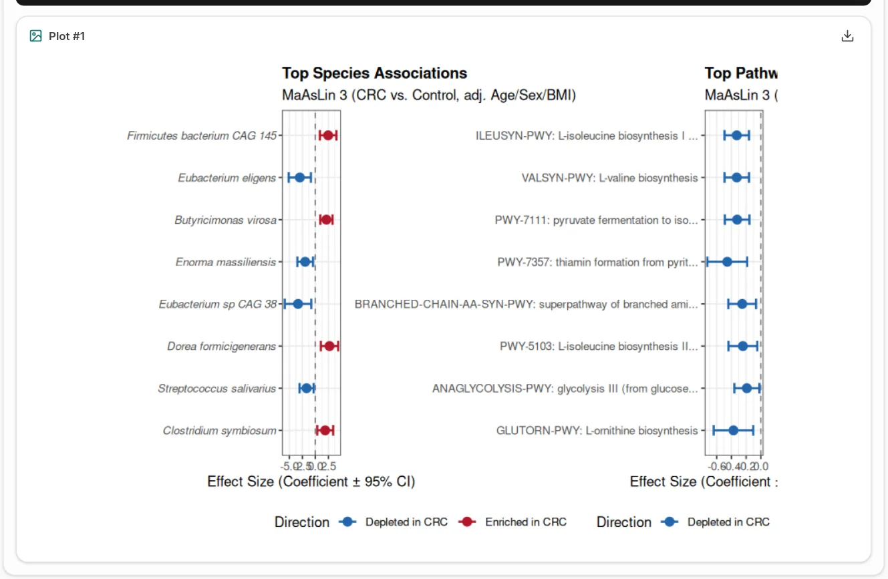

This page covers functional profiles of microbial communities, such as HUMAnN pathways and gene families, and gene set enrichment for results from expression studies.

## Prompts to try

1. Do pathways change along with species? ThomasAM_2018a is an Italian cohort with colorectal cancer, adenomas and controls. Send:

   ```text
   Load the species and pathway abundances of ThomasAM_2018a from curatedMetagenomicData.
   ```

   Then:

   ```text
   Run MaAsLin 3 on species for cancer versus control, adjusting for age, sex and BMI.
   ```

   Then:

   ```text
   Run the same model on the unstratified pathways. Do the significant pathways match the significant species?
   ```

2. Work with gene families. PehrssonE_2016 covers households in a Peruvian shantytown and a rural village in El Salvador. Send:

   ```text
   Load the gene family profiles of PehrssonE_2016 from curatedMetagenomicData.
   ```

   Then:

   ```text
   Why are UniRef gene families usually summarised before testing?
   ```

3. Ask about microbe set enrichment analysis on IBD data. Send:

   ```text
   Load the species relative abundances of HMP_2019_ibdmdb from curatedMetagenomicData, with age, disease and current antibiotic use.
   ```

   Then:

   ```text
   What is microbe set enrichment analysis, and how does it differ from testing one species at a time?
   ```

## What a note can do

- **Community function.** Notes load HUMAnN pathway, enzyme and gene family profiles from curatedMetagenomicData or a Zenodo record, or read yours, and test them between groups with the same methods as species ([Microbiome and metagenomics](microbiome.qmd)).
- **Gene sets.** msigdbr provides GO, Reactome and KEGG gene sets for human, mouse and other species.
- **Enrichment.** fgsea runs gene set enrichment analysis (GSEA) on ranked results.
- **Gene names.** org.Hs.eg.db and org.Mm.eg.db translate between gene IDs and symbols for human and mouse.
- **Single cells.** AUCell scores each cell for a gene set.

HUMAnN profiles and gene annotations are made from reads or genomes in [Reports on Roihu](../start/reports-roihu.qmd#bio-tools), with CSC tools such as HUMAnN, eggNOG-mapper, InterProScan, DIAMOND and HMMER. A note reads the resulting tables like any other upload.

## Example notes

<!-- screenshot: functional-species-pathways — species and pathway associations side by side in the "What pathways change in colorectal cancer?" note -->
{.screenshot fig-alt="Species and pathway associations side by side in the 'What pathways change in colorectal cancer?' note."}

- [What pathways change in colorectal cancer?](https://omicsbase.utu.fi/share/0XYFhfmIKUsPWDMlQsO7k): MaAsLin3 on species and on pathways, side by side.
- [Functional pathways in two Indian cities](https://omicsbase.utu.fi/share/_GLwDknmBx3VGOya5z23O): pathway abundances as the unit of analysis.
- [Gene families in households in Peru and El Salvador](https://omicsbase.utu.fi/share/9iVbSmKcq9dEfiXXIEYcl): filtering, naming and comparing gene families.
- [Microbe set enrichment analysis in IBD](https://omicsbase.utu.fi/share/siR6nEGjmPnOfpHMI9oS0): groups of microbes and of pathways tested against disease.
- [Zenodo: stroke, gut species and enzymes](https://omicsbase.utu.fi/share/vhCDIb-33VUDYyD2hRfFS): species and enzyme profiles tested together.
- [Pathways in malnourished children with diarrhoea](https://omicsbase.utu.fi/share/oUcAF0MImxBKMfPGzRBEH): in a very small study, little survives multiple testing correction.
- [Species and their transcribed enzymes in IBD](https://omicsbase.utu.fi/share/Mk3_AcgjybZrVGQrVhnXx): which species go with which active enzymes.
