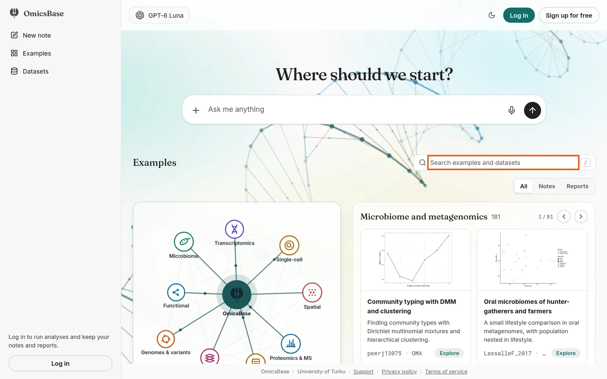
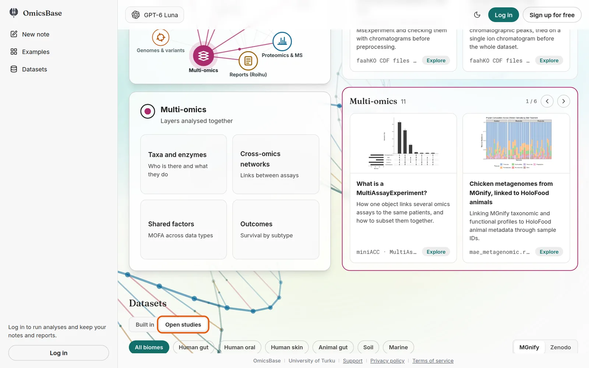

This section has one page for each kind of data. Each page gives you prompts to copy into a note, says in plain words what a note can do, and links to example notes. An example note is a real note on published data. You can open it and see every question, the R code, the output and the figures, just as they ran.

New to notes? Start with [Run your first note](../start/first-note.qmd). Want to use your own files? See [Add your own data](../start/your-data.qmd).

::: {.callout-note}
## Where each step runs

Notes analyse tables and profiles in R, such as counts, abundances and sample information. Work on raw sequencing reads, such as trimming, aligning, assembling or classifying them, runs in [Reports on Roihu](../start/reports-roihu.qmd#bio-tools), which has the command-line tools for it. The results, such as count tables and profiles, can then go into a note.
:::

## Pick your field

- [Microbiome and metagenomics](microbiome.qmd): microbes in the gut, mouth, soil and more.
- [Transcriptomics](transcriptomics.qmd): which genes are switched on, from bulk RNA-seq.
- [Single-cell](single-cell.qmd): genes in thousands of single cells.
- [Spatial](spatial.qmd): genes and cells in their place in a tissue.
- [Proteomics and metabolomics](proteomics-metabolomics.qmd): proteins and small molecules from mass spectrometry.
- [Functional annotation](functional.qmd): what genes and microbes do.
- [Genomes and variants](genomes.qmd): DNA sequences and trees.
- [Multi-omics](multi-omics.qmd): several kinds of data from the same people or samples.
- [Writing reports](reports.qmd): turn your analysis into a report.

## How to use the prompts

1. Open a new note.
2. Copy the first prompt and send it.
3. Wait for the result.
4. Send the follow-up prompt, if there is one.

A note does one step, shows you the result, and then stops and suggests what to do next. So send one step at a time.

You can also ask "why" before "how". For example: "Why should the patient, not the cell, be the unit of replication here?" Before a note writes code for a method, it looks the method up in the books listed below. It also reads the help page of any R function it has not used yet in that note.

## Find more examples

There are more than 300 example notes. You find them on the front page, [omicsbase.utu.fi](https://omicsbase.utu.fi), under **Examples**. After you sign in, click **Examples** in the sidebar.

<!-- screenshot: landing-examples-filters — the Examples section of the landing page with the search box, the field network and the All / Notes / Reports switch -->
{.screenshot fig-alt="The Examples section of the landing page with the search box, the field network and the All / Notes / Reports switch."}

1. Type a word in **Search examples and datasets**, for example a disease, a dataset or a method.
2. Click a field, such as **Microbiome**, **Single-cell** or **Spatial**, to jump to its examples. **All** shows every field.
3. Use the switch above the examples to show **All**, **Notes** or **Reports**.
4. Click an example to open it.

Under the examples, **Datasets** lists data you can start from:

- **Built in**: datasets from Bioconductor data packages.
- **Open studies**: microbiome studies from MGnify and Zenodo. You can narrow them by biome (**All biomes**, **Human gut**, **Human oral**, **Human skin**, **Animal gut**, **Soil**, **Marine**) and by **Source** (**MGnify** or **Zenodo**).

Click a dataset and a starter prompt appears in the message box.

<!-- screenshot: landing-datasets-open-studies — the Datasets section with Open studies selected, showing the biome buttons and the MGnify / Zenodo switch -->
{.screenshot fig-alt="The Datasets section with Open studies selected, showing the biome buttons and the MGnify / Zenodo switch."}

## The books behind the notes

Notes search 12 books about R and Bioconductor before they write code. Many example notes follow a chapter of one of these books, on the book's own data.

- Orchestrating Single-Cell Analysis with Bioconductor (OSCA)
- Orchestrating Single-Cell Analysis: Basics
- Orchestrating Single-Cell Analysis: Advanced
- Single-cell RNA-seq analyses with scrapper
- Orchestrating Spatial Transcriptomics Analysis with Bioconductor (OSTA)
- Workshop Materials for Tidy Spatial Analysis
- Orchestrating Microbiome Analysis with Bioconductor (OMA)
- RNA-Seq Workflow: Gene-Level Exploratory Analysis and Differential Expression (rnaseqGene)
- Tidyomics Analysis Tutorials and Workflows
- Multi-Omics Factor Analysis (MOFA2) Workflows
- R for Mass Spectrometry
- Metabonaut (Metabolomics)
