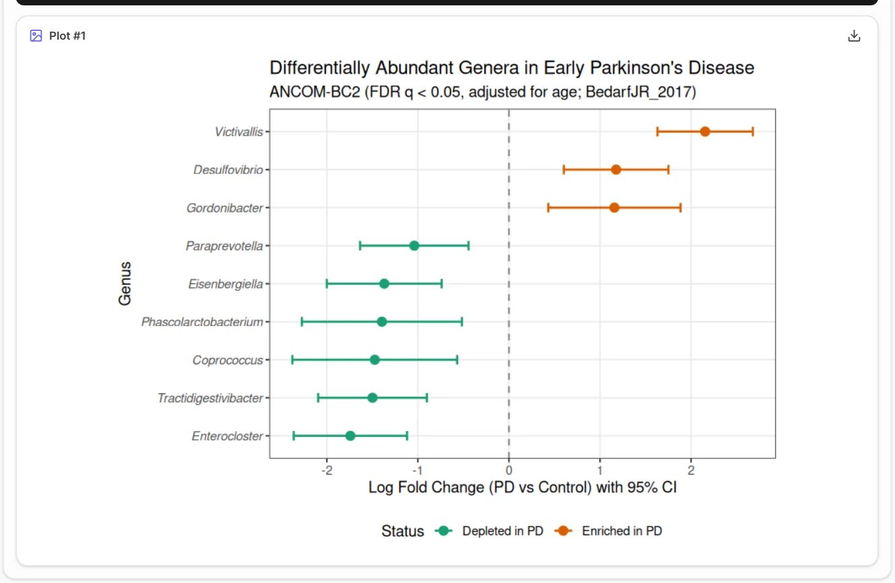

This page covers 16S amplicon and shotgun metagenomic data from gut, oral, soil and other communities. Notes start from count tables and taxonomic profiles.

## Prompts to try

1. Check how many false positives differential abundance testing gives on random groups. Send:

   ```text
   Load HMP_2012_16S_gingival_V13 from MicrobiomeBenchmarkData. Keep the supragingival samples from the first visit.
   ```

   Then:

   ```text
   If I split these samples into two random groups, how many genera should come out as differentially abundant?
   ```

2. Test differential abundance in Parkinson's disease. BedarfJR_2017 compares people with early Parkinson's disease and controls in Germany. Send:

   ```text
   Load BedarfJR_2017 from curatedMetagenomicData.
   ```

   Then:

   ```text
   Agglomerate to genus, keep genera present in at least 10% of samples, and run ANCOM-BC2 for Parkinson's versus control with age and sex as covariates.
   ```

3. List the analyses of an MGnify study. MGYS00006110 is 16S data from twelve French cheese varieties:

   ```text
   Use MGnifyR to list the analyses in MGnify study MGYS00006110. Don't fetch any results yet.
   ```

4. Import QIIME 2 artifacts from Zenodo. Record 5762485 has QIIME 2 files from a study of the brown bear gut microbiome. Send:

   ```text
   Download Zenodo record 5762485.
   ```

   Then:

   ```text
   Import the feature table, the taxonomy and the rooted tree .qza files into one TreeSummarizedExperiment.
   ```

5. Check for confounding by treatment. KarlssonFH_2013 is 70-year-old European women with normal, impaired or diabetic glucose control. Send:

   ```text
   Load KarlssonFH_2013 from curatedMetagenomicData.
   ```

   Then:

   ```text
   Which treatments are recorded? How many women take metformin?
   ```

## What a note can do

Notes hold the data in a TreeSummarizedExperiment, which keeps the counts, sample information and taxonomy in one object. They analyse it with mia and plot it with miaViz, following the book Orchestrating Microbiome Analysis (OMA).

- **Get data.** Notes load public studies from curatedMetagenomicData, HMP16SData, microbiomeDataSets, MGnify or HoloFood, or download a Zenodo record. They also read your tables, BIOM files, QIIME 2 files, DADA2 output, phyloseq objects, and MetaPhlAn and Kraken 2/Bracken profiles; see [Add your own data](../start/your-data.qmd).
- **Clean and group.** Notes filter out rare taxa and agglomerate counts to a rank such as genus.
- **Diversity.** Alpha diversity is computed within samples and beta diversity between them.
- **Ordination.** Ordination plots place similar samples close together.
- **Group tests.** PERMANOVA and RDA test whether groups of samples differ as a whole.
- **Differential abundance.** LimROTS, MaAsLin3, ANCOM-BC2, ALDEx2 or lefser test which taxa differ in abundance between groups.
- **More.** Community types (DirichletMultinomial), co-abundance networks (NetCoMi, SpiecEasi, SPRING), time series (miaTime), batch and study correction (MMUPHin), and classification from microbial profiles (SIAMCAT, mikropml).

Raw reads are trimmed, classified and profiled in [Reports on Roihu](../start/reports-roihu.qmd#bio-tools) with CSC tools such as fastp, Kraken 2, Bracken, MetaPhlAn and HUMAnN, and the profiles they produce can be uploaded to a note.

## Example notes

<!-- screenshot: microbiome-example-figure — a finished figure in the "Parkinson's disease and the gut with ANCOM-BC2" note, with the code cell above it -->
{.screenshot fig-alt="A finished figure in the 'Parkinson's disease and the gut with ANCOM-BC2' note, with the code cell above it."}

- [How many false positives?](https://omicsbase.utu.fi/share/Sq0r_YiM7dLT_T8uTRrTW): two random halves of the same samples are tested, where nothing should differ.
- [Seasons in the Hadza gut](https://omicsbase.utu.fi/share/fr7JQZRjzcaH9wvCO1gEe): which microbes differ between two camps of hunter-gatherers.
- [Parkinson's disease and the gut with ANCOM-BC2](https://omicsbase.utu.fi/share/aiX8hShwNDHM0cQq4Ztzs): genera that differ in patients, taking age and sex into account.
- [Confounding by metformin in type 2 diabetes](https://omicsbase.utu.fi/share/xcLdz-DSqooJAOK1hYv69): shows how metformin use changes the differential abundance result.
- [Why repeated samples need a random effect](https://omicsbase.utu.fi/share/1yPjv6E-M2LnkT502uIt1): modelling several samples from the same person.
- [Importing QIIME 2 artifacts: the brown bear gut](https://omicsbase.utu.fi/share/K1sBPIl1QifeHPTY2oiW1): from QIIME 2 files to diversity values.
- [MGnify: cheese rind and core](https://omicsbase.utu.fi/share/v2CKRGjqtCyDp7_mUHTaz): fetches part of an MGnify study and compares rind with core.
- [Learning a microbial association network](https://omicsbase.utu.fi/share/NOIxKQQVIrgvqngep-iDc): a co-abundance network of taxa.

## Tips

- If you ask to compare groups and do not name a method, the note follows the differential abundance chapter of the OMA book. It uses MaAsLin2 to compare two groups, also when you add covariates or interactions. It uses MaAsLin3 to look at two things apart: how often a microbe is present (prevalence), and how much there is of it where it is present (non-zero abundance). It shows the results with `plotBoxplot` and reports adjusted q-values. A method you name always comes first.
- Ask for ggplot2 if you want to style a figure yourself.
