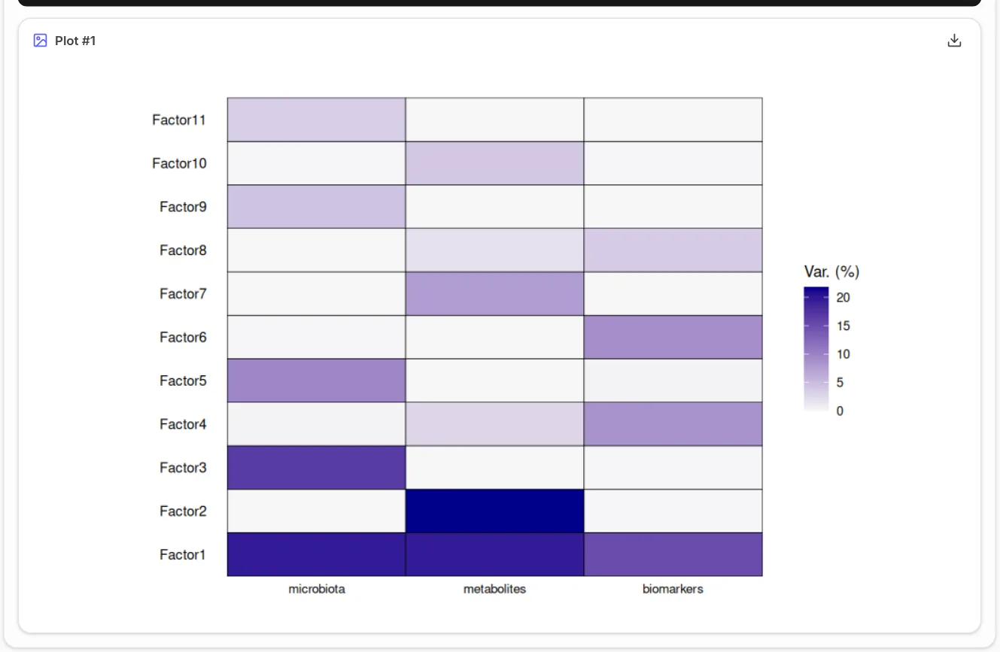

This page covers studies that measure several data types on the same people or samples, for example microbes and metabolites, or RNA and protein, and relate them to each other and to outcomes such as survival.

## Prompts to try

1. Compare survival between cancer subtypes. Send:

   ```text
   Load miniACC from MultiAssayExperiment. Which clinical columns describe survival?
   ```

   Then:

   ```text
   Build overall survival time from days_to_death and days_to_last_followup, with vital_status as the event.
   ```

   Then:

   ```text
   Plot Kaplan-Meier curves for the C1A and C1B mRNA subtypes with the survival package.
   ```

2. Inspect and filter a rat study with microbiota, metabolite and liver marker tables. Send:

   ```text
   Load HintikkaXOData from mia. What do the three experiments measure?
   ```

   Then:

   ```text
   Agglomerate the microbiota to genus and keep the most prevalent genera.
   ```

3. Subset linked metagenomes and metatranscriptomes to the first visit. Send:

   ```text
   Load ibdmdb from mia. How many participants and samples are there?
   ```

   Then:

   ```text
   Keep the first visit of each participant, the species-level rows of MGX and the unstratified enzyme rows of MTX.
   ```

4. Inspect the four data views of a leukaemia cohort:

   ```text
   Load the CLL data from MOFAdata. What are the four views, and how many samples does each have?
   ```

## What a note can do

Notes hold linked data in a MultiAssayExperiment, which ties several tables to the same people or samples, and follow the MOFA2 workflows and the multi-omics chapters of the OMA book.

- **Get data.** Notes load miniACC, curatedTCGAData, HintikkaXOData, ibdmdb, MOFAdata, SingleCellMultiModal, depmap or HoloFood data, or combine your tables.
- **Line up samples.** Notes keep the people or samples that appear in every table.
- **Links between tables.** Each feature in one table is correlated with each feature in another, for example species with enzymes.
- **Shared factors.** MOFA2 finds a few hidden factors that explain variation across all the tables at once. mixOmics offers related methods.
- **One map for two tables.** A joint ordination places samples using two tables together.
- **Outcomes.** The survival package fits Kaplan-Meier curves, log-rank tests and Cox models.

## Example notes

<!-- screenshot: multiomics-mofa-variance — the variance explained by each factor in each table, in the "MOFA on microbes, metabolites and liver markers in rats" note -->
{.screenshot fig-alt="The variance explained by each factor in each table, in the 'MOFA on microbes, metabolites and liver markers in rats' note."}

- [What is a MultiAssayExperiment?](https://omicsbase.utu.fi/share/TUJB6Yigl1zSK2CCN4Hk7): one object for several tables, and how to subset them together.
- [Survival by molecular subtype in adrenocortical carcinoma](https://omicsbase.utu.fi/share/2k2w4VB_esdjSX0wLTUq2): Kaplan-Meier curves and a log-rank test.
- [Does mRNA predict protein in adrenocortical carcinoma?](https://omicsbase.utu.fi/share/FgrWjj0qsCyf2OcZj7APl): RNA and protein for the same patients and genes.
- [MOFA on microbes, metabolites and liver markers in rats](https://omicsbase.utu.fi/share/phsU5du5NnJz6mmIRepWc): three tables prepared for MOFA, and the factors they share.
- [Multi-omics factor analysis of CLL patients](https://omicsbase.utu.fi/share/vDlL5aZyvPyTiN3ie4he4): drug response, methylation, RNA and mutations in one model.
- [Species and their transcribed enzymes in IBD](https://omicsbase.utu.fi/share/Mk3_AcgjybZrVGQrVhnXx): links between metagenomes and metatranscriptomes.
- [Joint ordination of metagenomes and metatranscriptomes](https://omicsbase.utu.fi/share/RNF7bVo41zSAZYVAk-ki5): one ordination from two linked tables.
- [Salmon fatty acids and gut microbes from HoloFood](https://omicsbase.utu.fi/share/ew_By6CxC0zE7HepmSSvw): host measurements and gut microbes from a feeding trial.
