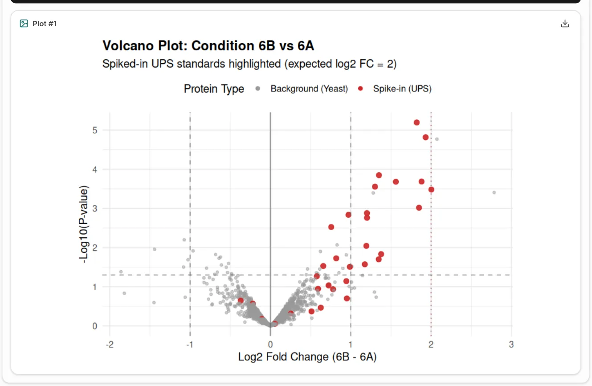

This page covers mass spectrometry data from proteomics and metabolomics. Notes read raw files in open formats, quantify peptides, proteins or metabolite features, and compare groups.

## Prompts to try

1. From peptides to proteins. Send:

   ```text
   Read the CPTAC peptide table from MsDataHub into a QFeatures object, with the condition, 6A or 6B, for each sample.
   ```

   Then:

   ```text
   Replace zeros with NA, remove peptides missing in 4 or more of the 6 samples, then remove reverse hits, contaminants and peptides with a PEP above 0.05.
   ```

2. Inspect the spectra of a TMT11 MS3 run:

   ```text
   Load the MS3TMT11 mzML file from MsDataHub with Spectra.
   ```

3. Detect chromatographic peaks in LC-MS metabolomics data. Send:

   ```text
   Load the faahKO CDF files from the faahKO package into an MsExperiment, with genotype labels.
   ```

   Then:

   ```text
   How does centWave decide what counts as a peak?
   ```

4. Annotate compounds from their MS2 spectra:

   ```text
   Load the PestMix1 DDA file from MsDataHub with Spectra and keep the MS2 spectra.
   ```

## What a note can do

The methods follow the books R for Mass Spectrometry and Metabonaut.

**Proteomics**

- **Raw spectra.** Spectra reads and plots mzML files.
- **Identifications.** PSMatch reads search results and uses decoy hits to judge them.
- **Quantification.** QFeatures keeps PSMs, peptides and proteins linked while it aggregates them, including TMT reporter ions.
- **Missing values.** Notes explore missingness and compare imputation methods.
- **Compare groups.** limma and msqrob2 find proteins that differ, shown in volcano plots.
- **More.** scp handles single-cell proteomics and pRoloc subcellular localisation.

**Metabolomics**

- **Raw data.** Notes read LC-MS files into an MsExperiment and check them with chromatograms.
- **Preprocessing.** xcms finds peaks (centWave), lines up retention times and matches peaks across samples.
- **Annotation.** MetaboAnnotation and CompoundDb match masses and fragment spectra to known compounds, for example from MassBank. MetaboCoreUtils works out masses and adducts.
- **Compare groups.** The features are collected into a table and tested between groups.

Data can come from MsDataHub, msdata, faahKO, scpdata and pRolocdata, or from your files. Notes read open formats such as mzML and CDF in R; convert vendor formats to mzML before you upload them.

## Example notes

<!-- screenshot: proteomics-volcano — the volcano plot in the "Spike-in proteins: from peptides to a volcano plot" note -->
{.screenshot fig-alt="The volcano plot in the 'Spike-in proteins: from peptides to a volcano plot' note."}

- [Reporter ions in a TMT11 MS3 run](https://omicsbase.utu.fi/share/EO_LG89UzF_5c-nPTXI8J): where the reporter ions appear in the spectra.
- [Peptide identifications and the target-decoy approach](https://omicsbase.utu.fi/share/ng0e2sCH6VaH86hpPQJop): judging search results with decoys.
- [From PSMs to proteins with QFeatures](https://omicsbase.utu.fi/share/5CjBGI3sLufBF4XDA2Vcq): aggregation from PSM to peptide to protein.
- [Spike-in proteins: from peptides to a volcano plot](https://omicsbase.utu.fi/share/V2M6cSUr7lFPto0GJPUK2): a full pipeline, checked against proteins known to be added.
- [Missing values in proteomics: to impute or not](https://omicsbase.utu.fi/share/-uDWnIa2hxaHurMC623ME): how much the choice of imputation method matters.
- [First look at untargeted LC-MS data](https://omicsbase.utu.fi/share/i56xBhTIzDdgh-SDMz-7p): raw files and chromatograms before any processing.
- [Chromatographic peak detection with centWave](https://omicsbase.utu.fi/share/nrEoiLfRqJjJiRRsk2OsM): peak finding tried on one ion first.
- [MS2 spectral matching against MassBank](https://omicsbase.utu.fi/share/bY4upPTH5Y_AzZahs47Jw): naming compounds by comparing fragment spectra.
