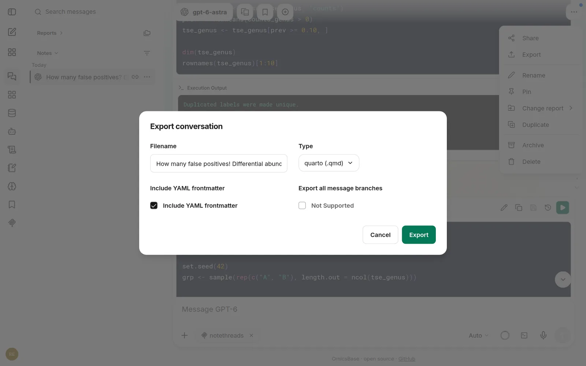

OmicsBase writes reports in Quarto, either from a single note or, for a whole project, in Reports.

## From a note

### Save the note as a Quarto file

1. Open the note's menu, the one with **Share** in it, and choose **Export**.
2. Under **Type**, pick `quarto (.qmd)`.
3. Tick **Include YAML frontmatter** if you want the title and settings at the top of the file.
4. Type a **Filename** and click **Export**.

The file has your questions as headings, the note's answers as text, and every R cell as a code chunk. Cells you later fixed or replaced are left out, so the file holds the version that worked. Open it in RStudio or another editor and render it with Quarto.

<!-- screenshot: note-export-quarto — the Export dialog with Type set to quarto (.qmd) and the Include YAML frontmatter box -->
{.screenshot fig-alt="The Export dialog with Type set to quarto (.qmd) and the Include YAML frontmatter box."}

### Ask the note to render a report

At the end of an analysis, ask the note to render its work as a small Quarto website; it replies with a link to the site. If there is no Quarto project yet, the note creates a simple one.

## In Reports

For a larger project, use Reports, where an analysis agent works through the project on your data and writes the report. On omicsbase.utu.fi it runs on CSC's Roihu supercomputer; [Reports on Roihu](../start/reports-roihu.qmd) explains the setup. Without a Roihu account, choose **Use my own computer** on the Reports page to run the agent on any machine with Docker.

<!-- screenshot: reports-rendered-site — a finished multi-page report open in Reports, with the file list and the agent beside it -->

A report from Reports is a multi-page Quarto website:

- The agent picks the chapters from your study and keeps the site menu in step with the pages.
- Each page has its R code folded and a table of contents at the side.
- As its last step, the agent renders the site, looks at the pages, figures and tables, and checks the numbers in the text against the R output.
- The first page starts with the study question and what the data support. Each result is linked to the question, the evidence, its interpretation and its limits.
- The report ends with `sessionInfo()`, which lists R and every package version used. Every session runs in the same fixed container image.

You can also ask for:

- a PDF or Word version,
- a methods section with references,
- each figure together with the table of numbers behind it.

## Tips

- Describe your study design and analysis plan to the agent; it chooses the chapters and methods from them.
- Reports does all its analysis in R and Quarto.
