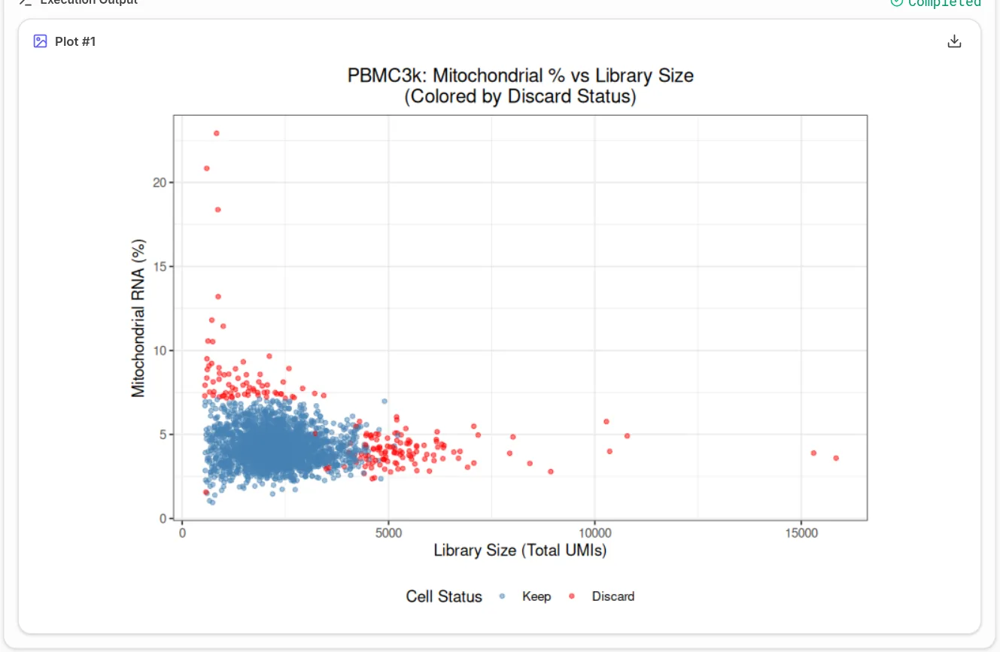

Single-cell RNA-seq measures genes in each cell on its own, often thousands of cells at once. In a note you can remove bad cells, group cells that look alike, name the cell types and follow cells as they change.

## Prompts to try

Copy a prompt into a new note and send it. When the result is back, send the follow-up.

1. Find low-quality cells. Send:

   ```text
   Load the pbmc3k dataset from TENxPBMCData. It is about 2,700 blood immune cells (PBMCs) from one healthy donor, sequenced by 10x Genomics.
   ```

   Then:

   ```text
   Compute per-cell QC metrics with scater, using the genes whose symbol starts with "MT-" as the mitochondrial set.
   ```

2. Name the cell types. Send:

   ```text
   Load the pbmc4k dataset from TENxPBMCData. It is about 4,000 blood cells from a healthy donor, sequenced by 10x Genomics. Use the gene symbols as row names.
   ```

   Then:

   ```text
   Run QC with scrapper, taking the mitochondrial genes from the "MT-" symbols, then normalise, pick variable genes, run a PCA, cluster and make a UMAP.
   ```

   Then:

   ```text
   Label each cell with SingleR against the Monaco reference, once with the main labels and once with the fine labels.
   ```

3. Compare treated and untreated cells, patient by patient. Send:

   ```text
   Load Kang18_8vs8 from muscData. It is blood cells from 8 lupus patients, split and either left untreated or stimulated with interferon-beta for 6 hours, then sequenced on 10x.
   ```

   Then:

   ```text
   Why should the patient, not the cell, be the unit of replication here?
   ```

4. Follow cells as they mature. Send:

   ```text
   Load the mouse embryo part of LaMannoBrainData from scRNAseq. It is developing mouse ventral midbrain from embryonic day 11.5 to 18.5, studied for its dopaminergic neurons.
   ```

   Then:

   ```text
   Which column has the cell types? Keep the radial glia, progenitors, neuroblasts and dopaminergic neurons.
   ```

## What a note can do

Notes keep the data in a **SingleCellExperiment**, one R object for the counts and the cell information. They follow the OSCA books and the scrapper book.

- **Get data.** Load public data from scRNAseq, TENxPBMCData, muscData, SingleCellMultiModal, TabulaMurisSenisData or HCAData. Raw 10x output and scanpy `.h5ad` files can be read too.
- **Quality control.** Find damaged cells with scater and scuttle, tell real cells from empty droplets with DropletUtils, and find doublets (two cells read as one) with scDblFinder.
- **Normalise and cluster.** Make cells comparable with scran or scrapper, then group cells that look alike (bluster) and draw a UMAP map of all cells.
- **Merge samples.** Remove differences between batches or donors with fastMNN (batchelor) or Harmony.
- **Name cell types.** SingleR compares each cell with a reference from celldex.
- **Trajectories.** slingshot and TSCAN order cells along a path, such as a stem cell becoming a mature cell.
- **Compare conditions.** Add up cells per patient (pseudo-bulk) and test with edgeR.
- **More than RNA.** Surface proteins (CITE-seq) and sample hashtags.

Notes start from count matrices, such as 10x output or `.h5ad` files, not from sequencing reads. Steps on raw reads run in [Reports on Roihu](../start/reports-roihu.qmd#bio-tools); CSC's [list of biology tools](https://docs.csc.fi/apps/bio-apps/) shows what is there.

Plots come from **scater**.

## Example notes

<!-- screenshot: single-cell-qc-plot — the plot of mitochondrial percentage against library size in the "What makes a cell low quality? 3k blood cells" note -->
{.screenshot fig-alt="The plot of mitochondrial percentage against library size in the 'What makes a cell low quality? 3k blood cells' note."}

- [What makes a cell low quality? 3k blood cells](https://omicsbase.utu.fi/share/Q84Un8slx3cxWtT6uIuPA): QC numbers for each cell and how to set cut-offs.
- [Telling cells from empty droplets](https://omicsbase.utu.fi/share/nuLHGaAaQ6NoxnhvK-fh7): raw 10x output and emptyDrops.
- [Naming blood cell types with a sorted-cell reference](https://omicsbase.utu.fi/share/L08gGYuKWm39Efyzn8V6E): SingleR labels, coarse and fine.
- [Merging blood cells from three donors with fastMNN](https://omicsbase.utu.fi/share/Feu8o9-u_CFeKFCEYWwfP): three donors in one map.
- [Interferon response by cell type with pseudo-bulk](https://omicsbase.utu.fi/share/ePKpA4S8KSu8hbcMQcfPA): treated against untreated, with patients as the replicates.
- [Pseudotime towards dopaminergic neurons](https://omicsbase.utu.fi/share/tzKHImSh_wawmlFTzuCqS): a TSCAN path and genes that change along it.
- [Clustering blood cells on surface proteins](https://omicsbase.utu.fi/share/tzxiKS8QLvZW9wIiQ_ox_): CITE-seq protein counts.
- [Reading a scanpy file into Bioconductor](https://omicsbase.utu.fi/share/K3nax9YEobrkLAoX4P4xM): an `.h5ad` file made in Python, opened in R.
