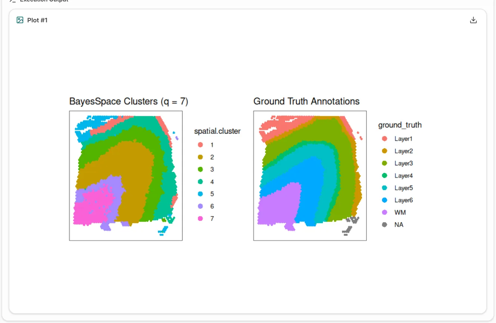

Spatial methods measure genes and keep the place in the tissue where each one was found. In a note you can check data quality, find regions of a tissue, and see which cells sit next to each other.

## Prompts to try

Copy a prompt into a new note and send it. When the result is back, send the follow-up.

1. Find regions of a brain section. Send:

   ```text
   Load Visium_humanDLPFC from STexampleData and keep the spots on the tissue.
   ```

   Then:

   ```text
   Preprocess the data for BayesSpace with 15 principal components.
   ```

   Then:

   ```text
   Cluster the spots into seven domains with nrep 1000 and a burn-in of 100, and set a seed.
   ```

2. Cell types or tissue regions? Send:

   ```text
   Load the hippocampus VeraFISH data that comes with Banksy and put it in a SpatialExperiment.
   ```

   Then:

   ```text
   What does BANKSY's lambda parameter control?
   ```

3. See which cells are neighbours in tumours. Send:

   ```text
   Load the single-cell object from IMMUcan_2022_CancerExample in imcdatasets. Which columns hold the image, the cell type and the coordinates?
   ```

   Then:

   ```text
   Build a k-nearest-neighbour spatial graph within each image, using cell_x and cell_y as coordinates.
   ```

4. Read the raw files from a Xenium machine:

   ```text
   Download the XeniumOutput example from SFEData. It's a small set of raw output files from a 10x Xenium run.
   ```

## What a note can do

Notes keep the data in a **SpatialExperiment** or **SpatialFeatureExperiment**, R objects that hold the counts together with the positions, images and cell outlines. They follow the OSTA book and the tidy spatial workshop.

- **Many platforms.** Visium, Slide-seq, the original Spatial Transcriptomics array, seqFISH, MERFISH and MERSCOPE, CosMx, Xenium, STARmap PLUS and imaging mass cytometry. Raw Xenium and CosMx output can be read into R.
- **Quality control.** Find bad spots or cells, including local outliers and tissue damage with SpotSweeper.
- **Spatially variable genes.** nnSVG finds genes whose level follows a pattern across the tissue.
- **Tissue regions.** BayesSpace and BANKSY group spots or cells into regions, using their neighbours as well as their genes.
- **Patterns in space.** Measures such as Moran's I and Getis-Ord show where a gene or score clusters (Voyager, spdep).
- **Neighbours.** hoodscanR, imcRtools and spicyR test which cell types sit together more often than by chance.
- **Mixtures.** SPOTlight and spacexr estimate which cell types make up each spot.

Notes start from the files the instrument's own software writes, such as Visium, Xenium or CosMx output, not from sequencing reads.

Plots come from **ggspavis**, which draws the data on the tissue.

## Example notes

<!-- screenshot: spatial-domains — BayesSpace domains next to the manual layers in the "Spatial domains with BayesSpace" note -->
{.screenshot fig-alt="BayesSpace domains next to the manual layers in the 'Spatial domains with BayesSpace' note."}

- [A first look at a Visium brain section](https://omicsbase.utu.fi/share/Pt6TfGXmaR53mt2_UC7N2): what is stored where, and genes drawn on the tissue image.
- [Spot-level quality control on Visium](https://omicsbase.utu.fi/share/b-oe97353amWb3WNNQJFF): which spots to remove, checked against the tissue.
- [Spatially variable genes with nnSVG](https://omicsbase.utu.fi/share/adJFLovQMm3QLvfbUUxTg): genes with a pattern in space.
- [Spatial domains with BayesSpace](https://omicsbase.utu.fi/share/LzwjVZ1Faxy22SBEz0oet): regions compared with the known brain layers.
- [Cell types versus tissue domains with BANKSY](https://omicsbase.utu.fi/share/2ST5k-dbtSjCisr-XhIeX): how one setting switches between the two.
- [Which cells sit next to each other in tumours?](https://omicsbase.utu.fi/share/fWgVMZeI78N0hrDH6ORNJ): neighbour tests on imaging mass cytometry.
- [From raw Xenium files to an object](https://omicsbase.utu.fi/share/7ble_tWWA1onOt__2sN-s): machine output to an R object with cell outlines.
- [Cell classes across slices of the hypothalamus](https://omicsbase.utu.fi/share/hJYFU7EbAvFR2pINPOefN): a MERFISH atlas across several slices.
