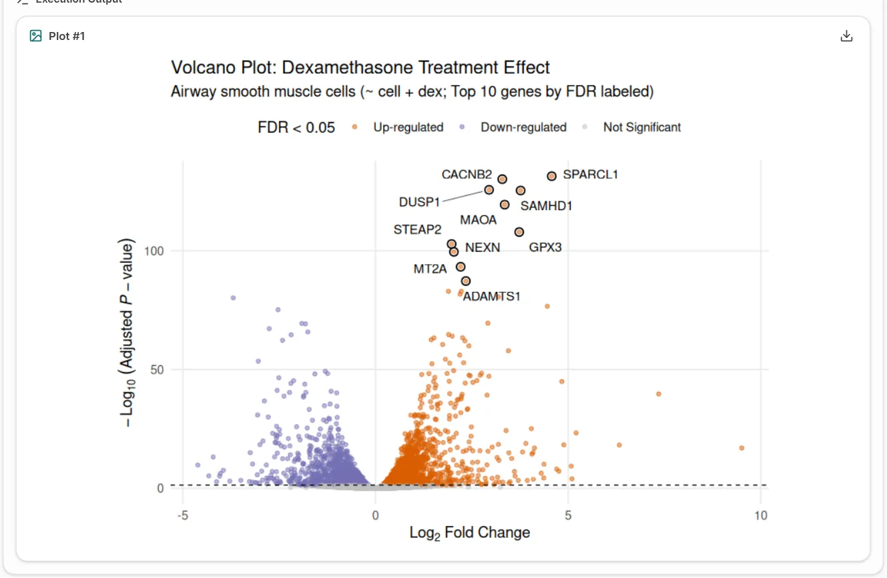

This page covers bulk RNA-seq, starting from a gene count table or Salmon quantifications. The methods come from the rnaseqGene workflow and the tidyomics tutorials.

## Prompts to try

1. Find genes that respond to dexamethasone in airway smooth muscle cells. Send:

   ```text
   Load airway from the airway package and set untreated as the reference level of dex.
   ```

   Then:

   ```text
   Run DESeq2 with cell line and treatment in the design.
   ```

   Then ask why:

   ```text
   Why include the cell line in the model?
   ```

2. Prepare Salmon counts for limma-voom. The gse object in the airway package holds Salmon gene counts. Send:

   ```text
   Load the gse object from the airway package. What is in colData?
   ```

   Then:

   ```text
   Make a DGEList with tximeta's makeDGEList, filter lowly expressed genes and compute TMM factors.
   ```

3. Build a DESeq2 dataset that leaves out the cell lines:

   ```text
   Load airway from the airway package and build a DESeq2 dataset with treatment only, as if we didn't know the cell lines.
   ```

4. Load a count table and its sample annotation:

   ```text
   Load the pasilla gene count table and sample annotation from the extdata folder of the pasilla package.
   ```

## What a note can do

- **Get data.** Notes load public data such as airway, pasilla, macrophage, fission or recount3, or read your count table. tximeta or tximport read Salmon or other quantifications.
- **Look first.** A PCA of the samples shows their structure before any test.
- **Find changed genes.** DESeq2, edgeR and limma (with voom) test for differential expression between groups, with other factors such as donor or batch in the design.
- **Sharper results.** apeglm shrinks noisy fold changes, IHW weights the multiple testing to gain power, and sva estimates hidden sources of variation such as unknown batches.
- **Tidy style.** tidybulk applies tidyverse verbs to the same data.
- **Gene sets.** Pathway and gene set analysis of the results is covered in [Functional annotation](functional.qmd).

Reads are aligned or quantified in [Reports on Roihu](../start/reports-roihu.qmd#bio-tools) with CSC tools such as HISAT2, STAR, Salmon and Trinity. Upload the counts or Salmon output to a note to continue there.

## Example notes

<!-- screenshot: transcriptomics-volcano — the volcano plot in the "Dexamethasone response in airway smooth muscle cells" note -->
{.screenshot fig-alt="The volcano plot in the 'Dexamethasone response in airway smooth muscle cells' note."}

- [Exploring the airway RNA-seq samples](https://omicsbase.utu.fi/share/8MMaS7IJ7zlRQ3Wajdn0m): counts made comparable and a sample PCA, before any test.
- [Dexamethasone response in airway smooth muscle cells](https://omicsbase.utu.fi/share/NFrFVhfYAQlvZStXRsKrO): DESeq2 from model to volcano plot.
- [limma-voom on Salmon-quantified airway data](https://omicsbase.utu.fi/share/Pg07hJCdo0tTK5o1OoINS): why counts need weights in a linear model.
- [Hidden batch effects in airway with sva](https://omicsbase.utu.fi/share/5B7km2KvOYPPj3-yDXGtW): sva recovers the cell lines from the data alone.
- [Pasilla knockdown with fold change shrinkage](https://omicsbase.utu.fi/share/TDtQHGjpwaCYo4TWd-BXw): a DESeq2 dataset built from a count table.
- [Independent filtering and IHW](https://omicsbase.utu.fi/share/S1bQaE3cSDQBSeMtOQgE3): why testing genes with very few reads costs power.
- [Interferon response by cell type with pseudo-bulk](https://omicsbase.utu.fi/share/ePKpA4S8KSu8hbcMQcfPA): single cells summed per patient, then tested with edgeR.
