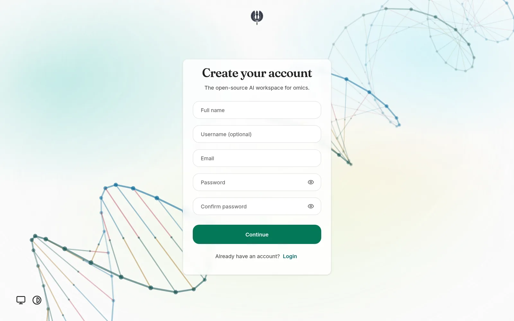

You can run OmicsBase on your own computer. You get notes and Reports, as on [omicsbase.utu.fi](https://omicsbase.utu.fi), and you use your own model. Both run the R stack only: R, Bioconductor and their packages, without command-line bioinformatics tools such as fastp, Kraken 2, read aligners or assemblers. For those, use [Reports on Roihu](../start/reports-roihu.qmd#bio-tools) on omicsbase.utu.fi.

## What you need {#what-you-need}

- [ ] A computer with an Intel or AMD processor. A Mac with an Apple chip (M1 or newer) also works, but slowly.
- [ ] About 30 GB of free disk space.
- [ ] 8 GB of memory or more.
- [ ] An internet connection. The first install downloads about 8 GB.
- [ ] A key from a model provider (OpenRouter, OpenAI, Anthropic or Google), or a model in Ollama on this computer.

## Install {#install}

### 1. Get Docker {#step-docker}

Docker is a program that runs OmicsBase in sealed boxes, called containers, so you do not have to install R or anything else yourself.

::: {.panel-tabset}

## Linux

Install Docker Engine with the `docker-compose-plugin` package, or Docker Desktop, from <https://docs.docker.com/get-docker/>.

Then allow your user to use Docker: add yourself to the `docker` group, then log out and log in again.

## Mac

Install Docker Desktop from <https://docs.docker.com/get-docker/> and start it.

## Windows (WSL)

WSL (Windows Subsystem for Linux) lets Windows run Linux. OmicsBase runs in its Ubuntu window.

1. Install Docker Desktop from <https://docs.docker.com/get-docker/> and start it.
2. In Docker Desktop, turn on WSL integration for Ubuntu.

<!-- screenshot: docker-desktop-wsl-integration — Docker Desktop settings with the WSL integration switch for Ubuntu turned on -->

:::

**You see:** Docker is installed. On a Mac or Windows, the Docker Desktop window says Docker is running.

### 2. Give Docker enough memory {#step-memory}

::: {.panel-tabset}

## Linux

With Docker Engine, nothing to do: Docker can use all of your computer's memory. With Docker Desktop, set **Settings > Resources > Memory** to 8 GB or more.

## Mac

Docker Desktop has its own memory limit. Open Docker Desktop, go to **Settings > Resources > Memory**, and set it to 8 GB or more.

On a Mac with an Apple chip, also turn on **Settings > General > Use Rosetta**. It makes OmicsBase faster there.

<!-- screenshot: docker-desktop-memory — Docker Desktop at Settings > Resources > Memory, with the slider at 8 GB -->

## Windows (WSL)

Docker Desktop has its own memory limit. Open Docker Desktop, go to **Settings > Resources > Memory**, and set it to 8 GB or more.

<!-- screenshot: docker-desktop-memory — Docker Desktop at Settings > Resources > Memory, with the slider at 8 GB -->

:::

**You see:** the memory setting shows 8 GB or more.

### 3. Open a terminal {#step-terminal}

A terminal is a window where you type commands.

::: {.panel-tabset}

## Linux

Open the **Terminal** app.

## Mac

Open the **Terminal** app. It is in Applications > Utilities.

## Windows (WSL)

Open **Ubuntu** from the Start menu. Use this window for every command on these pages, not PowerShell.

:::

**You see:** a window with a blinking cursor, waiting for you to type.

### 4. Run the install command {#step-command}

Copy this line, paste it into the terminal and press Enter:

```bash
curl -fsSL https://raw.githubusercontent.com/0xMuluh/omicsbase/main/install.sh | sh
```

The first time, it takes a while: it downloads about 8 GB.

**You see** at the end:

```text
OmicsBase is running: http://localhost:3080

  Create an account there; the first one becomes the admin.
  Bring a model: paste a key (OpenRouter, OpenAI, Anthropic or Google) when you pick a
  model, or start a model in Ollama on this machine.
  A model in Ollama runs on this computer: its first answer can take a minute while
  Ollama loads it, and replies are slower than with a hosted model.

  Stop:    cd /home/you/omicsbase && docker compose down
  Update:  run the install command again
```

Lines that start with `Note:` are warnings; the install carries on. If you see `OmicsBase was not installed:`, it stopped. Look up the message in [Troubleshooting](troubleshooting.qmd).

### 5. Create your account {#step-account}

Open <http://localhost:3080> in your web browser. Click **Sign up**, fill in **Full name**, **Email**, **Password** (at least 8 characters) and **Confirm password**, then click **Continue**.

<!-- screenshot: local-sign-up-page — the browser at http://localhost:3080 showing the OmicsBase sign-up form -->
{.screenshot fig-alt="The browser at http://localhost:3080 showing the OmicsBase sign-up form."}

The first account on your install becomes the admin.

<!-- screenshot: local-first-account — OmicsBase just after the first account was created, showing the landing page with the example notes -->

**You see:** OmicsBase, with 18 example notes on the landing page.

### 6. Pick a model {#step-model}

Notes need a model. Pick one in the model picker:

- **With a key:** choose OpenRouter, OpenAI, Anthropic or Google, and paste your key when asked. Each person enters their own key, and it is stored encrypted for them.
- **With Ollama:** models you have already pulled in [Ollama](https://ollama.com) on this computer appear under **Ollama**, with no key. Pick one that supports tool calls; notes need them.

**You see:** the model's name in the picker. Ask your first question; see [Your first note](../start/first-note.qmd). For which models work well, see [Pick a model](../start/models.qmd).

## Stop and start {#stop-start}

Stop OmicsBase:

```bash
cd ~/omicsbase && docker compose down
```

Start it again:

```bash
cd ~/omicsbase && docker compose up -d
```

Your accounts, notes and files are kept while it is stopped. While it runs, OmicsBase starts again by itself when Docker starts, for example after you restart your computer.

To update, run the install command again. See [Updating and backups](updating.qmd).

## Good to know {#good-to-know}

### Who can reach it {#who-can-reach-it}

OmicsBase opens at <http://localhost:3080> and only on this computer. Other computers on your network cannot open it.

Anyone who can open the address on this computer can create an account. Each account has its own notes, but Reports runs in one shared container, so accounts on the same install can reach each other's reports.

### What leaves your computer {#what-leaves}

Notes and Reports run on your computer. Your questions, code and results go only to the model provider you chose. Apart from that, OmicsBase downloads what it needs (the images, the example notes, and the R packages and public data you ask for), and the Reports page loads its font from Google Fonts.

### Ollama on Linux {#ollama-linux}

On Linux, Ollama normally accepts connections only from programs on the computer itself, and OmicsBase, inside Docker, cannot reach it. The install command then prints a note with the fix. See [Ollama is running but only for this machine's own programs](troubleshooting.qmd#ollama-local-only).

### Where things are {#where-things-are}

Everything lives in `~/omicsbase` (on Windows, in your Ubuntu home folder):

| Path | What it holds |
| --- | --- |
| `.env` | Your settings and the generated secrets. Keep it private. See [Settings](settings.qmd). |
| `data/` | Accounts, notes, uploaded files, Reports work and caches |
| `examples/` | The example notes, loaded into the app each time it starts |
| `docker-compose.yml`, `librechat.yaml`, `reports-gate.Caddyfile`, `import_examples.js`, `.env.example` | Setup files, replaced on every update. Do not edit them; put your changes in `.env`. |

Inside `data/`:

| Folder | What it holds |
| --- | --- |
| `mongodb/` | The database: accounts, notes and their messages |
| `projects/` | Files of notes and Reports projects: data, figures, reports |
| `app/` | App data, including the keys the app made for itself on first start |
| `uploads/`, `images/` | Files and images uploaded in the app |
| `meilisearch/` | The search index |
| `engine-cache/` | Downloaded ExperimentHub and AnnotationHub data, so it is not fetched again |
| `reports/` | The Reports agent's settings and conversations |
| `reports-link/` | Links to machines added with **Use my own computer** |
| `logs/` | App logs |

### What the install command does {#what-it-does}

1. **Checks your computer.** It stops if `curl`, Docker or Compose v2 is missing, or if Docker is not running. It warns, and carries on, if disk space or Docker's memory is low, if the computer is ARM, or if Ollama on Linux cannot be reached.
2. **Downloads the setup files** into `~/omicsbase`. With a pinned version, it takes the files released with that version.
3. **Writes your settings** to `~/omicsbase/.env` the first time, with your user and group id and new secrets. Only you can read the file. Later runs keep it, add secrets a newer version needs, and write in a version you ask for.
4. **Creates the data folders** in `~/omicsbase/data/`.
5. **Downloads the example notes** and checks them against their published checksum. OmicsBase works without them.
6. **Downloads the images** (about 8 GB the first time) and starts them.
7. **Waits for the app** to answer on <http://localhost:3080>, for up to 5 minutes.

To install into another folder, or a particular version, see [Install-time settings](settings.qmd#install-time).

### Use more powerful machines {#bigger-machines}

OmicsBase can stay on your laptop while the heavy work runs elsewhere:

- **Notes:** run the notes engine on a server. See [Notes engine on a server](engine-server.qmd).
- **Reports:** choose **Use my own computer** on the Reports page. See [Reports on your own computer](../start/reports-own-computer.qmd).

How the parts fit together is described in [Architecture](../develop/architecture.qmd).
