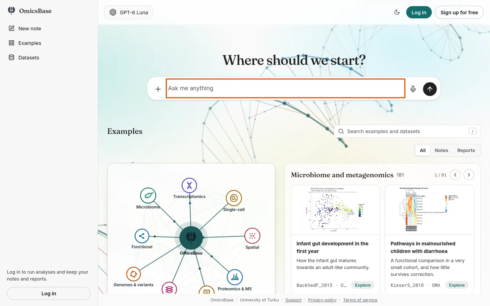
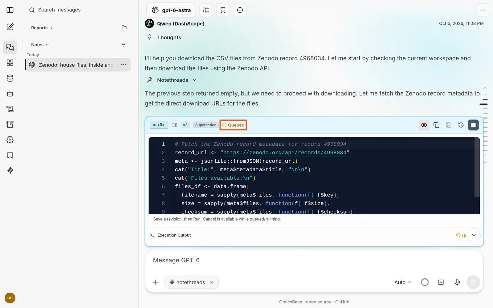
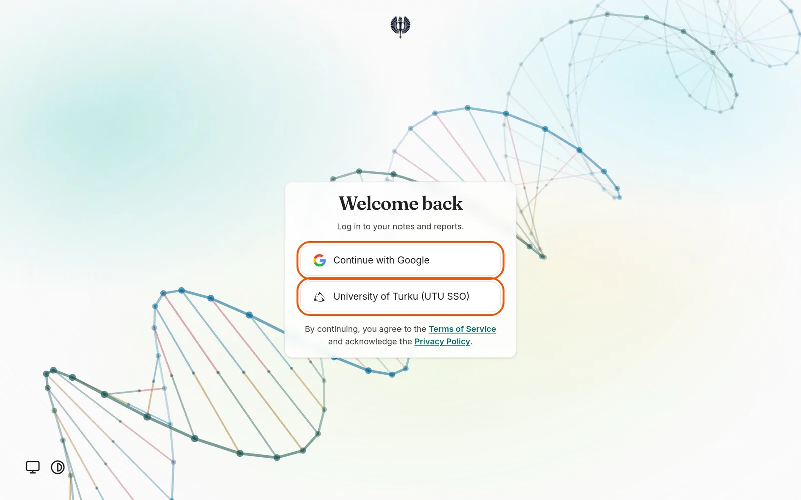
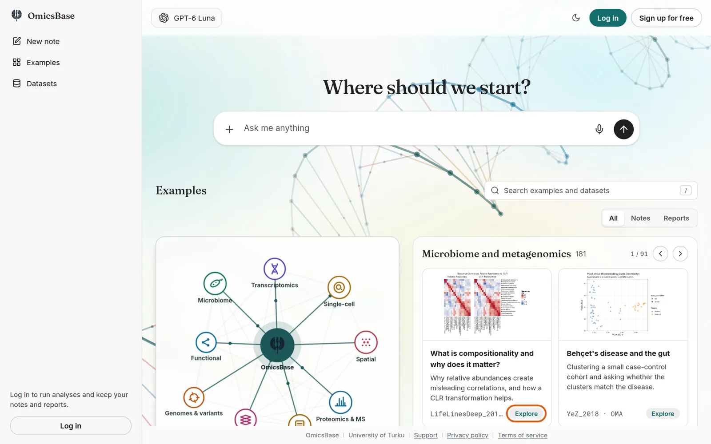
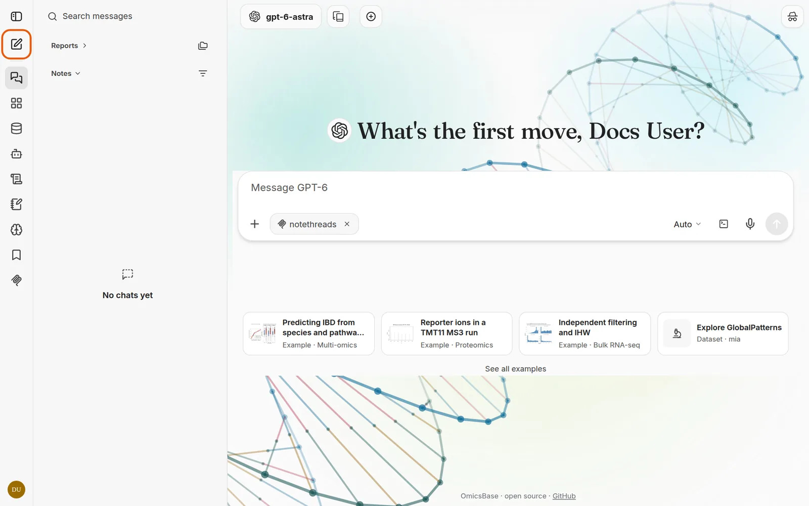
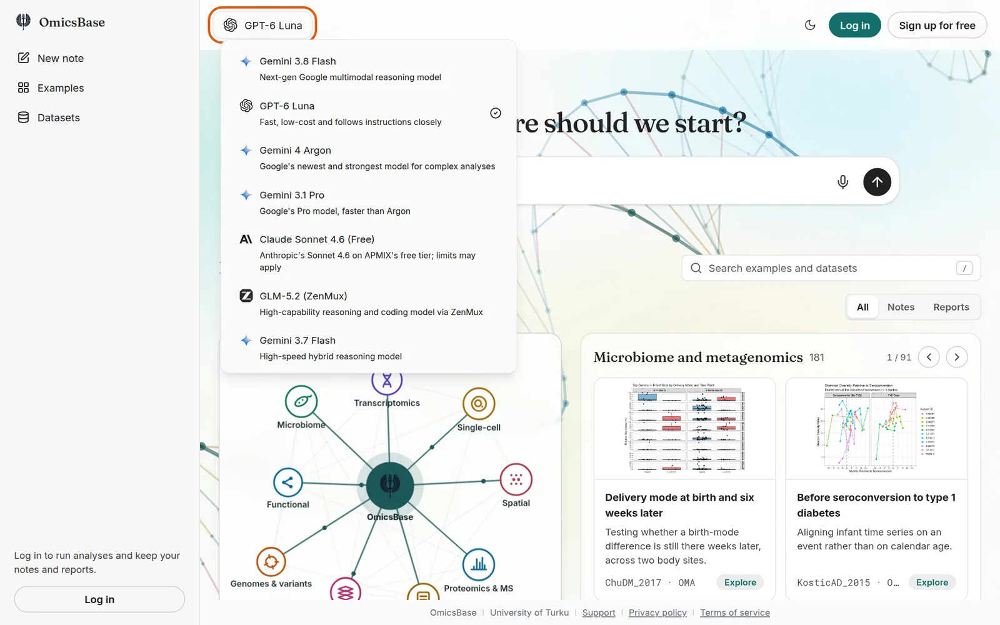
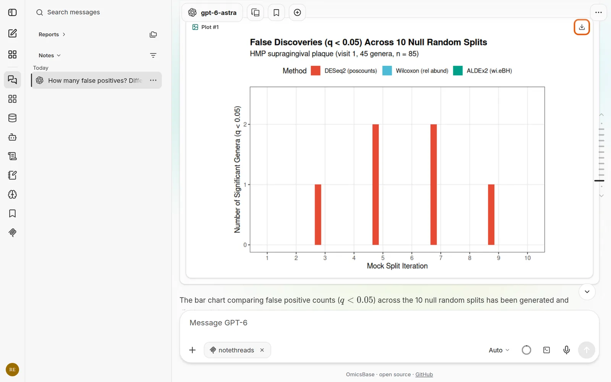
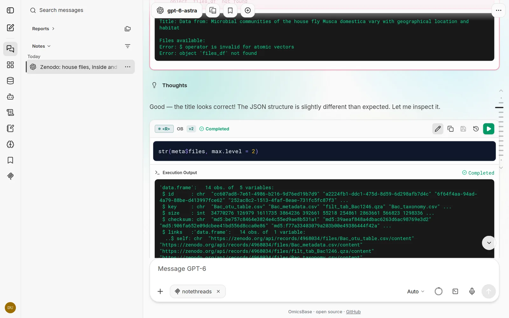

A **note** is where you ask OmicsBase a question about your data. An AI helper, called the agent, writes R code, runs it for you and shows the results in the note. R is the programming language that most biology data tools are written in.

This page takes you from signing in to your first result.

## Ask your first question {#ask}

1. Go to [omicsbase.utu.fi](https://omicsbase.utu.fi).
   You see the start page. It says **Where should we start?** above a box with the words **Ask me anything**.

   <!-- screenshot: landing-page — the signed-out start page with "Where should we start?", the "Ask me anything" box, and Log in at the top right; highlight the box -->
   {.screenshot fig-alt="The signed-out start page with 'Where should we start?', the 'Ask me anything' box, and Log in at the top right."}

2. Click in the box and type your question in plain words.
   For example: `Load GlobalPatterns from mia and give me an overview of what it contains.`
3. Press **Enter**, or click the arrow button (**Send**).
   The sign-in page opens. Your question waits for you while you sign in.
4. Sign in (see [Sign in](#sign-in) below).
   A new note opens with your question already typed in the message box at the bottom.
5. Press **Enter**, or click the arrow button (**Send message**).
   The agent starts working. You see its reply grow in the note, step by step.

   <!-- screenshot: first-reply — a note where the agent's reply is coming in, with one R cell showing "Running"; highlight the cell status -->
   {.screenshot fig-alt="A note where the agent's reply is coming in, with one R cell showing 'Running'."}

Read [What you get back](#what-comes-back) to understand the reply.

## Sign in {#sign-in}

You need a University of Turku account or a Google account.

1. On the start page, click **Log in** at the top right.
   A page opens with the sign-in choices.
2. Click **University of Turku (UTU SSO)** if you have a University of Turku account, or **Continue with Google** to use a Google account.
   The sign-in page of your university or of Google opens.

   <!-- screenshot: sign-in-choices — the sign-in page with the two buttons "University of Turku (UTU SSO)" and "Continue with Google"; highlight both -->
   {.screenshot fig-alt="The sign-in page with the two buttons 'University of Turku (UTU SSO)' and 'Continue with Google'."}

3. Sign in there as you normally do.
   OmicsBase opens a new, empty note.

**Sign up for free** on the start page leads to the same sign-in choices.

## What is on the start page {#start-page}

The start page is what you see before you sign in. It has:

- **Ask me anything**: the box where you type a question.
- A button at the top left that shows the model's name. A model is the AI that writes the code. You can pick a different one here; see [Pick a model](models.qmd).
- **Examples**: finished notes on published data. Click a card's **Explore** button to read the whole note. Cards with **Read report** show a finished Report.
- **Datasets**: data you can start from right away. **Built in** lists datasets that are already installed. **Open studies** lists public microbiome studies from MGnify and Zenodo.
- **Search examples and datasets**: a search box for both lists.

   <!-- screenshot: landing-examples — the Examples section of the start page with field filters and example cards; highlight one card's Explore button -->
   {.screenshot fig-alt="The Examples section of the start page with field filters and example cards."}

Click a dataset card and its first question is typed into the box for you. Then send it as in [Ask your first question](#ask).

After you sign in, the same lists are under **Examples** and **Datasets** in the sidebar on the left.

## Start a new note {#new-note}

1. Click **New note** in the sidebar on the left.
   An empty note opens. Under the message box you see **Suggestions**: three example notes and one dataset.

   <!-- screenshot: new-note — an empty note with the message box, the model button at the top and the Suggestions cards below; highlight New note in the sidebar -->
   {.screenshot fig-alt="An empty note with the message box, the model button at the top and the Suggestions cards below."}

2. Check the model's name on the button at the top of the note. To change it, see [Pick a model](#pick-a-model).
3. Type your question in the message box and press **Enter**.
   The agent starts working.

Your notes are listed under **Note History** in the sidebar. Click one to open it again.

## Pick a model {#pick-a-model}

1. Click the button at the top of the note that shows the model's name (its tooltip says **Select a model**).
   A list of models opens, each with a short description.
2. Click the model you want.
   The button now shows that model's name. Your next message uses it.

   <!-- screenshot: model-picker-open — the open model list with descriptions; highlight the button at the top that opens it -->
   {.screenshot fig-alt="The open model list with descriptions."}

[Choose a model](models.qmd) explains what the labels mean and how to use your own key.

## What you get back {#what-comes-back}

The agent works in small steps. In each reply it usually:

1. Looks up how to do the task in the Bioconductor books and in the R help pages. You may see these look-ups listed in the reply.
2. Writes a few lines of R code in an **R cell** and runs it.
3. Reads the result and tells you in plain words what it found.
4. Stops and suggests the next step, so you stay in charge.

Each R cell shows:

- **The code** that ran. Click the copy button (**Copy R code**) to copy it.
- **A status**: **Queued** (waiting), **Running**, **Completed**, **Failed**, **Timed out** (it took too long) or **Cancelled**.
- **Execution Output**: the text that R printed.
- **Table Preview**: the first rows of a table, with its size, such as "(120 rows × 8 cols)". The download button saves the table.
- **Plot #1**, **Plot #2** and so on: the figures. Click the download button (**Download plot**) to save one.

<!-- screenshot: r-cell-result — a completed R cell with its code, the "Completed" status, Execution Output and a plot; highlight the Copy R code and Download plot buttons -->
{.screenshot fig-alt="A completed R cell with its code, the 'Completed' status, Execution Output and a plot."}

The code has really run. The numbers and figures come from your data, not from the agent's imagination. The agent is told never to make up data or results. If a step fails, it reads the error, fixes the code and tries once more. If it fails again, it stops and explains.

## Keep going {#continue}

Type your next request in the message box, for example `Now compare the groups` or `Make the plot bigger and colour by sample type`.

Each note keeps its own R session. A session is R's memory: the tables and results made in earlier cells stay there, so the next step can use them.

- **The agent stopped in the middle.** In one reply the agent can only take about ten actions, look-ups included. Type `continue` and send it.
- **You come back later.** OmicsBase saves the note's R memory when you leave it alone for a while. When you return and run something, it is loaded again. The output then starts with a line saying the R session was restarted and how many saved objects were restored.

## Change a cell and run it again {#rerun-a-cell}

You can fix or change code that the agent wrote and run it yourself.

1. In the R cell, click the pencil button (**Edit code**).
   The code opens in an editor.
2. Change the code.
   The cell shows **Unsaved**.
3. Click the save button (**Save revision**).
   **Unsaved** goes away.
4. Click the green play button (**Run code in NoteKernel**).
   The status changes to **Queued**, then **Running**, then **Completed** or **Failed**. The new output replaces the old one.

   <!-- screenshot: edit-cell — an R cell in edit mode with the editor open; highlight the Edit code, Save revision and Run code in NoteKernel buttons -->
   {.screenshot fig-alt="An R cell in edit mode with the editor open."}

To see earlier runs of the same cell, click the clock button (**Execution history**) and pick a run from the list.

::: {.callout-note}
A cell you run yourself stops after 3 minutes. A cell the agent runs stops after 10 minutes. When time runs out, the status shows **Timed out**. Ask the agent to split the work into smaller steps or to use a smaller part of the data.
:::

## Stop the agent {#stop}

- **To stop the agent's reply:** while it works, the send button turns into a stop button (**Stop generating**). Click it.
- **To stop one R cell:** while the cell is **Queued** or **Running**, click the square button on the cell (**Cancel execution**). The status changes to **Cancelled**.

## Next steps

- [Choose a model](models.qmd)
- [Add your own data](your-data.qmd)
- [Share a note](share.qmd)
- [Prompts to try for each kind of data](../analyses/index.qmd)
