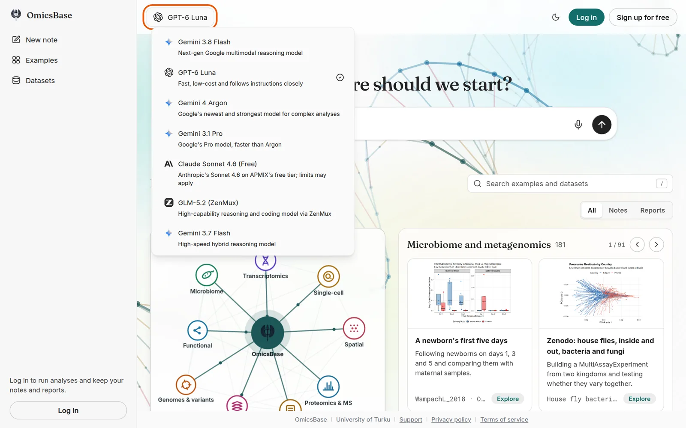

A **model** is the AI that reads your question and writes the R code. Models come from different companies; some are faster, and some handle long analyses better. You can change the model at any time.

## Pick a model {#pick-a-model}

1. Open a note, or start one with **New note** in the sidebar.
2. Click the button at the top of the note that shows the model's name. Its tooltip says **Select a model**.
   A list opens. Each model has a name and a one-line description.

   <!-- screenshot: model-picker — the open model list showing names and descriptions; highlight the button at the top of the note -->
   {.screenshot fig-alt="The open model list showing names and descriptions."}

3. To find a model by name, type in the search box at the top of the list (**Search models...**).
   The list shrinks to the models that match.
4. Click the model you want.
   The list closes. The button now shows the new model's name.

Your next message uses the new model. You can switch in the middle of a note.

::: {.callout-tip}
Pick from the models listed at the top of the list. Each of them is set up with the tools that notes need: running R, reading the Bioconductor books and looking up R help.
:::

On the start page, before you sign in, a short list is behind the button at the top left. The model you pick there is used when your note opens, if your sign-in offers it.

## Models for your sign-in {#models-by-sign-in}

The models at the top of the list depend on how you [signed in](first-note.qmd#sign-in).

| You signed in with | Models | Selected at first |
| --- | --- | --- |
| A University of Turku account | **GPT-6 Luna**, **Claude Sonnet 5.5**, **Gemini 4 Hydrogen** | GPT-6 Luna |
| Another Haka or eduGAIN organisation, or Google | **Nemotron 3 Ultra (Free)** | Nemotron 3 Ultra (Free) |

Everyone can also use models with [their own key](#add-a-key) from Anthropic, OpenAI, Google or OpenRouter.

## What the labels mean {#kinds-of-models}

The list changes as new models come out. The name of a model or of its group tells you how it is paid for:

| Name | Means |
| --- | --- |
| No label, such as **GPT-6 Luna** | OmicsBase pays. The cost comes out of your [credits](#credits). |
| Ends with **(Free)** | The model runs on a provider's free plan. The provider may limit how much you can use it. |
| A group ending with **(own key)**, such as **Anthropic (own key)** | You pay through your account at that provider. It uses none of your OmicsBase credits. You need to [add your key](#add-a-key) first. |

## Which model to choose {#choose}

- **Not sure?** Keep the model that is already selected.
- **A long analysis with many steps?** Pick a model whose description says it is for complex or harder analyses.
- **The agent keeps getting the code wrong?** Try a different model for the next message. Models differ in how well they write R.
- **Out of credits?** [Add your own key](#add-a-key) and pick a model from its **(own key)** group.

Read the description under each name in the list. It says what the model is good at.

## Use your own key {#add-a-key}

With an API key from your account at a model provider, you can use that provider's models in notes, and the cost goes to that account. Each provider has a group in the model list:

| Group in the model list | Key you need |
| --- | --- |
| **Anthropic (own key)** | An Anthropic API key, for the Claude models |
| **OpenAI (own key)** | An OpenAI API key, for the GPT models |
| **Google (own key)** | A Gemini API key, for the Gemini models |
| **OpenRouter (own key)** | An OpenRouter API key. OpenRouter gives one key for models from many companies. |

To add a key from the model list:

1. Click the model button at the top of the note.
   The model list opens.
2. Find the group for your provider, such as **Anthropic (own key)**.
3. Point at the small button on the right of that row and click it when it shows **Set API Key**.
   A box opens with the title **Set API Key for** and the group's name, such as **Set API Key for Anthropic (own key)**.

   <!-- screenshot: set-key-button — the model list with the "OpenRouter (own key)" row and its Set API Key button; highlight the button -->

4. Paste your key into the key field.
5. Under **New key expiration**, choose how long OmicsBase should keep the key. The choices go from **in 30 minutes** to **never**. If you do nothing, it is kept **in 12 hours**.
6. Click **Submit**.
   The box closes and a message says **API key saved successfully**.

   <!-- screenshot: set-key-dialog — the "Set API Key for OpenRouter (own key)" box with the key field, New key expiration and Submit; highlight Submit -->

7. Open the group again and pick a model from it, as in [Pick a model](#pick-a-model).
   With your key saved, the group lists the models the provider offers to your key.

You can also add and check your keys in one place: click your name in the sidebar, then **Settings** → **Data & Privacy**. Under **API keys**, next to **Provider API keys**, click **Manage**. The box lists the four groups. Each shows **No key set** or when its key expires, and a button: **Set API Key** to add a key, or **Update** to replace it.

<!-- screenshot: provider-keys — Settings, Data & Privacy, the Provider API keys box with the four (own key) rows; highlight Set API Key on one row -->

OmicsBase stores your key encrypted and deletes it when it expires. When the key has expired, add it again with the same steps.

If the message box says **Set your Key in the Header menu to use notes.**, the selected model needs a key that is missing or expired. Add it with the steps above.

### Remove your key {#remove-a-key}

- **One key:** open the **Set API Key for** box of that group as above and click **Revoke**. Confirm with **Revoke**.
- **All keys at once:** click your name in the sidebar, then **Settings** → **Data & Privacy**, and use **Revoke all provider API keys**.

## Credits {#credits}

Models that OmicsBase pays for use **credits**. Every account gets 5,000,000 credits each day. 1,000,000 credits stand for one US dollar of model use.

- Your credits are set back to 5,000,000 once a day.
- Unused credits do not carry over to the next day.
- Models in the **(own key)** groups use no credits.

### See how many credits you have {#see-credits}

1. Click your name in the sidebar.
   A menu opens.
2. Click **Settings**.
   The settings window opens.
3. Click **Account**.
4. Look under **Billing** at **Token balance**.
   You see how many credits you have left and when they are set back.

   <!-- screenshot: token-balance — Settings, Account tab, Billing section with Token balance; highlight the balance -->

### When you run out {#out-of-credits}

If a message needs more credits than you have, the note says **You do not have enough token credits for this request.** and shows how many it needs. You can:

- wait until your credits are set back the next day, or
- [add your own key](#add-a-key) and pick a model from its **(own key)** group.

## What the model provider sees {#what-the-provider-sees}

The company that runs the model you picked receives what the model needs to answer: your messages, the code it writes and what R prints back. If the model comes through OpenRouter, OpenRouter passes the request on to that company. The provider's terms decide how long it keeps what it receives. For files you upload, see [What the model sees of your files](your-data.qmd#what-the-model-sees); for personal data, see [What is sent to the model provider?](faq.qmd#what-leaves-the-server)
