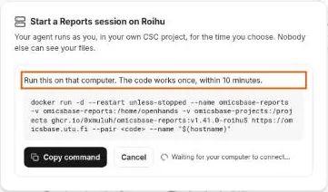
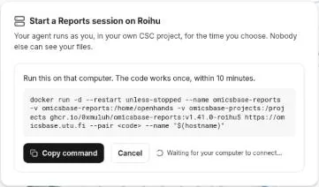

Reports can also run on your own computer, such as a laptop or a cloud server, with Docker. There it has R, Bioconductor and your choice of agent. The computer connects out to OmicsBase, so you open no ports. Files are stored on that computer; what the agent reads or prints goes to the model provider of your key, and what the workspace shows passes through OmicsBase. No CSC account is needed.

::: {.callout-important}
## R and Bioconductor only

Reports on your own computer has R, Bioconductor and their packages. Command-line bioinformatics tools, such as fastp, Kraken 2, read aligners and assemblers, are available in [Reports on Roihu](../start/reports-roihu.qmd#bio-tools).
:::

## What you need {#requirements}

- [ ] **Docker**: Docker Engine on Linux, Docker Desktop on a Mac or Windows. On Windows, type the commands in an Ubuntu (WSL) terminal with Docker Desktop's WSL integration turned on.
- [ ] **Disk space**: about 6 GB to download and about 20 GB once installed.
- [ ] **Outbound internet access** to omicsbase.utu.fi, openhands.omicsbase.utu.fi and your model provider.
- [ ] **Your own model key** for the model the agent uses. See [Models](models.qmd).

The software is built for Intel and AMD processors; Apple-silicon Macs and other ARM computers run it slowly through emulation. The computer must be on while you work.

## Pair your computer {#pair}

Pairing links your computer to your OmicsBase account. You do it once.

1. Sign in at [omicsbase.utu.fi](https://omicsbase.utu.fi), choose **Reports** in the sidebar and open a report.

2. Choose the **Workspace** tab at the top of the report.
   You see the Roihu form, and below it **Or use your own computer**.

3. [Choose **Use my own computer**.]{#start}
   A panel shows two commands: **1. Download the software on that computer (about 6 GB, once):** with a `docker pull` command, and **2. When that has finished, run this there. The code works once, within 10 minutes.** with a `docker run` command. Under them, **Code valid for** counts down the time the code has left.

   <!-- screenshot: use-own-computer-panel — the panel with the docker pull and docker run commands; highlight the two Copy command buttons and "Code valid for 9:58." -->
   {.screenshot fig-alt="The panel with the docker pull command and the docker run command."}

4. [Choose **Copy command** under the first command, paste it into a terminal on your computer and press Enter.]{#download}
   Docker downloads the software, about 6 GB, once. The download can take longer than the code lasts; keep the OmicsBase page open.

5. [When the download has finished, copy the second command and run it in the same terminal.]{#pairing-code}
   If the panel says **This code has expired.** by then, choose **Get a new code** first; the panel shows a new command and restarts the countdown. While the code is valid the panel shows **Waiting for your computer to connect…**

   <!-- screenshot: pairing-waiting — the pairing card with both commands, Copied, Cancel, the spinner "Waiting for your computer to connect…" and "Code valid for 7:42." -->
   {.screenshot fig-alt="The pairing card with both commands, Cancel, the spinner 'Waiting for your computer to connect…' and the time the code is still valid."}

6. [Wait until the bar appears.]{#workspace}
   A bar at the top says **Running on** and your computer's name. Below it is your workspace: the agent, your files and the report preview.

   <!-- screenshot: own-computer-bar — the green "Running on <computer name>" bar above the workspace; highlight the Disconnect button -->

7. Choose an agent and add your model key. [How](#agent-and-model).

The pairing persists: after a restart the computer reconnects as soon as Docker is running, until you [disconnect](#disconnect) it.

The commands look like this, with your code and version filled in. Copy them from OmicsBase:

```bash
docker pull ghcr.io/0xmuluh/omicsbase-reports:<version>

docker run -d --restart unless-stopped --name omicsbase-reports \
  -v omicsbase-reports:/home/openhands -v omicsbase-projects:/projects \
  ghcr.io/0xmuluh/omicsbase-reports:<version> \
  https://omicsbase.utu.fi --pair <your-code> --name "$(hostname)"
```

### If the code has expired {#expired-code}

A code works once, within 10 minutes. When the countdown reaches zero the panel says **This code has expired.** Choose **Get a new code** and run the new command. Docker keeps the download, so only the second command is needed.

If you ran a command whose code had already expired, the container says so in its log (`docker logs omicsbase-reports`) and waits. Remove it with `docker rm -f omicsbase-reports`, then run the new command.

## Choose an agent and add your key {#agent-and-model}

1. In the workspace header, open the agent menu and choose an agent under **Switch Agent Engine**.
2. Open the agent's settings in the workspace and paste the key from your model provider.

The agent sends its requests from your computer straight to your model provider, with your key. The requests carry what the agent reads and prints, including the contents of files it opens. [Getting a key](models.qmd).

## Disconnect {#disconnect}

1. Choose **Disconnect** in the bar.
2. Confirm the question **Disconnect this computer? Its files stay on it, but it can no longer reach OmicsBase until you pair it again.**
3. On your computer, remove the container:

   ```bash
   docker rm -f omicsbase-reports
   ```

<!-- screenshot: disconnect-confirm — the Disconnect button in the bar and the browser's confirmation question -->

To use the computer again, [pair it](#pair) with a new command.

## More detail {#more}

::: {#files .callout-note collapse="true"}
## Where your files are

Your files are stored on your computer in two Docker volumes, which Docker keeps when the container is removed:

| Volume | Holds |
| --- | --- |
| `omicsbase-projects` | Your reports, one folder per report (`/projects` in the container) |
| `omicsbase-reports` | The agent's settings and conversations, and the computer's pairing details (`/home/openhands` in the container) |

You see and edit the files in the workspace. To copy a report out of the container:

```bash
docker cp omicsbase-reports:/projects/<report-folder> .
```

Your browser reaches the agent through OmicsBase, so what the workspace shows passes through the OmicsBase server.

To delete the files permanently, remove the volumes after removing the container. This cannot be undone:

```bash
docker volume rm omicsbase-reports omicsbase-projects
```
:::

::: {#local-install .callout-note collapse="true"}
## With OmicsBase installed on your laptop

If you run OmicsBase on your laptop with the [installer](../self-host/install.qmd), Reports runs on the laptop, and the bar above the workspace says **Reports runs on this computer.** You can move Reports to a bigger computer, such as a lab server or a cloud machine.

In this setup the laptop connects to the other computer on port 8443. The laptop must be able to reach that computer by name or IP address (same network, a VPN or the internet), with port 8443 open to it. Two computers that are both behind home or office routers cannot reach each other this way.

### Pair with a pairing string {#pairing-string}

1. In the laptop's Reports workspace, choose **Use my own computer** in the bar.
   You see a `docker run` command ending in `serve --address <name or IP of that computer>`.
2. Choose **Copy command**.
3. On the other computer, paste the command, replace `<name or IP of that computer>` with the name or IP address at which the laptop reaches it, and press Enter.
4. On that computer, run `docker logs omicsbase-reports` and copy the line that starts with `omicsbase-machine:`. The first start downloads about 6 GB; the line appears when the download has finished. Anyone with the line can open that computer's agent, so keep it private.
5. On the laptop, paste the line into **Pairing string** and choose **Connect**.
   You see **Connecting to** and the computer's address, usually for a few seconds. Then the bar says **Running on** and the address.

**Disconnect** returns Reports to the laptop. The container keeps running on the other computer until you remove it with `docker rm -f omicsbase-reports`. To connect again, paste the same pairing string.

Pairing strings work only with OmicsBase installed on a laptop. On omicsbase.utu.fi, pair with the command and its code.
:::

::: {#troubleshooting .callout-note collapse="true"}
## Troubleshooting

### On the Reports page {#page-errors}

| Message | What to do |
| --- | --- |
| **… is not connected** and **Start it again on that computer: docker start omicsbase-reports** | Your computer is off, Docker is not running, or the container stopped. Run `docker start omicsbase-reports`; it reconnects by itself. |
| **OmicsBase cannot reach … on port 8443. Check that this computer can reach it, or Disconnect.** | With OmicsBase on your laptop: the other computer did not answer within a minute of **Connect**. Check the address you gave after `--address`, that the container runs there (`docker ps`), and that the laptop can reach its port 8443. OmicsBase keeps trying; or choose **Disconnect** and pair again. |
| **You already have a Reports session. Stop it first.** | You have a session on Roihu or on another computer. Stop or disconnect it first. |
| **This browser could not connect to your session.** | Choose **Try again**. If it keeps failing, check that the container runs: `docker ps`. |
| **Pairing strings are for local installs. Use the pairing code instead.** | On omicsbase.utu.fi, [pair](#pair) with the `docker run` command and its code. |
| **That is not a pairing string. Copy the whole line that starts with omicsbase-machine:** | Run `docker logs omicsbase-reports` again and copy the full line, from `omicsbase-machine:` to its end. |
| **Paste the pairing string your computer printed.** | Paste the `omicsbase-machine:` line from `docker logs omicsbase-reports` into **Pairing string**. |
| **Using your own computer is not set up on this server.** or **Pairing a computer is not set up on this server.** | This OmicsBase does not offer it. Ask whoever runs it. |
| **Something went wrong. Try again in a moment.** | Try again. If it keeps happening, report it with the time. |

### In the container's log {#log-errors}

See the log with `docker logs omicsbase-reports`. When pairing works it shows `OmicsBase Reports: this machine is paired with https://omicsbase.utu.fi; open Reports there.`

| Message | What to do |
| --- | --- |
| **OmicsBase Reports: this pairing code is unknown, used or expired. Run docker rm -f omicsbase-reports, then get a new command in Reports.** | The code is unknown, already used or older than 10 minutes, and the container is idle. Run `docker rm -f omicsbase-reports`, choose **Get a new code** in Reports and run the new command. |
| **OmicsBase Reports: you already have a Reports session running. Stop it in Reports, run docker rm -f omicsbase-reports, then get a new command there.** | Stop your Roihu session or disconnect your other computer, remove this container and run a new command. |
| **OmicsBase Reports: could not reach https://omicsbase.utu.fi: …** | Your computer cannot reach OmicsBase. Check its internet connection, proxy or firewall. |
| **OmicsBase Reports: this machine is not paired yet. Start it with the command shown in Reports.** | The container started without a code. Remove it and run the command from Reports. |

If `docker run` says the name `omicsbase-reports` is already in use, an old container is still there. Run `docker rm -f omicsbase-reports` and the command again.
:::

More questions: [FAQ](faq.qmd).
