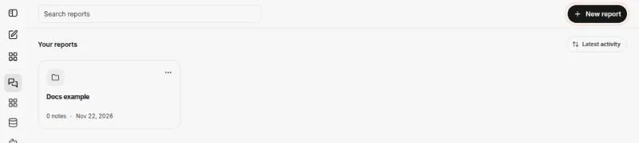
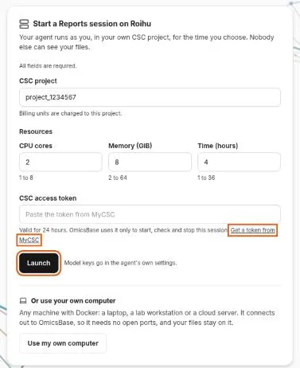

In Reports, an AI agent writes and runs the code for a report of your analysis. On omicsbase.utu.fi the agent runs on Roihu, the supercomputer of CSC (Finland's centre for scientific computing). It runs in a job under your CSC account, reads and runs the files in your workspace, and sends what it reads or prints to the model provider of your key ([what is sent](faq.qmd#what-leaves-the-server)). Besides R and Bioconductor, a session on Roihu can use about 300 bioinformatics tools from CSC, such as fastp, Kraken 2, MetaPhlAn, minimap2 and SPAdes, so an analysis can start from raw sequencing reads (FASTQ files). See [Bioinformatics tools on Roihu](#bio-tools).

If you have no CSC account, run Reports on [your own computer](reports-own-computer.qmd).

## What you need {#what-you-need}

- [ ] **A CSC account**. [How to get one](#csc-account).
- [ ] **A CSC project with Roihu**, which pays for computing time. [How to join or create one](#csc-project).
- [ ] **A CSC access token**, valid for one day, which OmicsBase uses to start Roihu for you. Get a new one each time you start. [How to get one](#access-token).
- [ ] **Your own model key** for the model the agent uses. See [Models](models.qmd).

## Start a session {#start}

1. Sign in at [omicsbase.utu.fi](https://omicsbase.utu.fi).

2. Choose **Reports** in the sidebar.

   <!-- screenshot: reports-page — the Reports list in the sidebar and main area; highlight the Reports item and the New report button -->
   {.screenshot fig-alt="The Reports list in the sidebar and main area."}

3. Open a report. To make one, choose **New report**, type a **Report name** and choose **Create report**.

4. Choose the **Workspace** tab at the top of the report.
   A form opens: **Start a Reports session on Roihu**.

5. Type your **CSC project**, keep the suggested **CPU cores**, **Memory (GiB)** and **Time (hours)**, and paste your token into **CSC access token**. [What each field means](#launch).

   <!-- screenshot: launch-form-filled — the Roihu form with project_1234567, 2 cores, 8 GiB, 4 hours and a masked token; highlight the Get a token from MyCSC link and the Launch button -->
   {.screenshot fig-alt="The Roihu form with project_1234567, 2 cores, 8 GiB, 4 hours and a masked token."}

6. Choose **Launch**.
   A card shows what Roihu is doing. The [first time in a project](#first-launch) it says **Preparing Reports for project_1234567** for about 5 minutes. Then it shows **Waiting for a Roihu node** and **Starting your agent**. Keep the page open.

   <!-- screenshot: preparing-card — the card "Preparing Reports for project_1234567" with its spinner and the Stop session button -->

7. Wait until the bar appears.
   A bar at the top says **Roihu session running**, with your project, cores and memory. Below it is your workspace: the agent, your files and the report preview. It may take a few seconds before the workspace responds.

   <!-- screenshot: session-bar — the green "Roihu session running" bar with project, cores, memory and end time; highlight the Stop session button on the right -->

8. Choose an agent and add your model key. [How](#agent-and-model).

   <!-- screenshot: workspace — the running workspace with the agent panel, the file tree and the agent menu open on Switch Agent Engine -->

One session serves all your reports. Start it once, then open any report's **Workspace** tab.

When you are done, [stop the session](#stop).

## The form {#launch}

All fields are required.

| Field | What to enter | Allowed |
| --- | --- | --- |
| **CSC project** | Your project's ID, such as `project_1234567`. Find it under *Projects* in [MyCSC](https://my.csc.fi). The session's billing units are charged to this project. | `project_` and seven digits |
| **CPU cores** | How many processors the agent and its R code use. Suggested: 2. | 1 to 8 |
| **Memory (GiB)** | How much memory. Suggested: 8. Give more for big data, such as assemblies or large single-cell data. | 2 to 64 |
| **Time (hours)** | How long the session may run. Suggested: 4. | 1 to 36 |
| **CSC access token** | The token from MyCSC. The **Get a token from MyCSC** link under the field opens the token page. | Any token |

More cores, memory and hours cost more of your project's billing units; see [What it costs](#charges).

### The first launch in a project {#first-launch}

The first time anyone in a project launches Reports, Roihu downloads the Reports software into the project. Later launches by any member of that project reuse it and start faster. After a new version of OmicsBase, the software is downloaded once more.

## Choose an agent and add your key {#agent-and-model}

1. In the workspace header, open the agent menu. Its tooltip says **Agent:** and the agent's name.
2. Under **Switch Agent Engine**, choose **Default OpenHands**, **Codex Agent**, **Claude Code**, **Gemini CLI**, **Pi** or **OpenCode**. Switching starts a new conversation with the agent.
3. Open the agent's settings in the workspace and paste the key from your model provider.

The agent sends its requests from Roihu straight to your model provider, with your key. The requests carry what the agent reads and prints, including the contents of files it opens. The models you use in notes do not apply here. [Getting a key](models.qmd).

## The session bar {#session-bar}

While your session runs, the bar at the top says **Roihu session running**, then your project, cores and memory, and the end time once Roihu reports it, for example `project_1234567 · 2 cores · 8 GiB · until 16:30`. **Stop session** is on the right.

If you see **This browser could not connect to your session.**, choose **Try again**.

## Stop the session {#stop}

1. Choose **Stop session** in the bar.
2. Confirm the question **Stop your Reports session on Roihu? Your files stay in your project folder.**

You see **Your session was stopped.** and the form again. Your project pays only for the time the session runs, so stop it when you are done.

When the time you chose runs out, the session stops by itself and you see **Your session reached its time limit.**

## Bioinformatics tools on Roihu {#bio-tools}

A session on Roihu has R and Bioconductor, like a note, and can use CSC's collection of about 300 command-line biology tools.

Some of the tools, by step:

| Step | Tools |
| --- | --- |
| Check read quality | FastQC, MultiQC |
| Trim reads | fastp, Trimmomatic, cutadapt |
| Align reads to a reference | bwa, bwa-mem2, bowtie2, minimap2, HISAT2, STAR |
| Count RNA | Salmon |
| Assemble genomes and transcripts | SPAdes, MEGAHIT, Canu, Trinity, and QUAST, BUSCO and CheckM2 to check the result |
| Find genes | Prodigal, Prokka |
| Annotate genes and proteins | Prokka, InterProScan, eggNOG-mapper, DIAMOND, HMMER |
| Name the microbes in a sample | Kraken 2, Bracken, MetaPhlAn |
| Profile what the microbes can do | HUMAnN |
| Handle alignments and find variants | samtools, bcftools, GATK, freebayes |
| Genome-wide association (GWAS) | PLINK |

CSC keeps reference databases on Roihu for Kraken 2, MetaPhlAn, BLAST and DIAMOND. Kraken 2 and MetaPhlAn are set up to find theirs.

The agent loads a tool with `module load` when a step needs it, for example `module load bio-apps/v202603` and then `module load fastp/1.3.6`. It loads only what the step needs, because some tools need a particular version of another tool. To use a tool, name it in your request:

```text
The paired FASTQ files in data/reads are stool metagenomes. Trim them with fastp, classify the reads with Kraken 2 and estimate species abundances with Bracken. Then load the Bracken tables into a TreeSummarizedExperiment.
```

Steps such as assembly need more memory; set it in [the form](#launch). Count tables and profiles from these steps can be uploaded to a note and analysed there in R.

Every tool, with its versions and how to use it, is in CSC's [list of biology tools](https://docs.csc.fi/apps/bio-apps/). [Reports on your own computer](reports-own-computer.qmd) has R and Bioconductor only.

## Get ready with CSC {#csc-setup}

You do this once.

### Get a CSC account {#csc-account}

If you work at a Finnish university, university of applied sciences or research institute:

1. Go to [MyCSC](https://my.csc.fi), CSC's website for accounts, and choose *Create account*.
2. Choose *Haka* (universities and research institutes) or *Virtu* (government agencies), and sign in with your work account.
3. Fill in the sign-up page, set your CSC password from the email CSC sends, and set up a login code app on your phone when asked.

If you have no Haka or Virtu login, for example because you work abroad, ask the manager of your group's CSC project to contact the CSC Service Desk. CSC's guide: [How to create a new CSC user account](https://docs.csc.fi/accounts/how-to-create-new-user-account/).

### Join or create a CSC project {#csc-project}

A CSC project holds your group's billing units, which pay for your sessions. Its ID looks like `project_1234567`.

#### Join your group's project {#join-project}

Ask your group's project manager to add you in MyCSC, or to send you the project's invitation link. CSC's guide: [How to add members to a project](https://docs.csc.fi/accounts/how-to-add-members-to-project/).

#### Create your own project {#create-project}

Staff of Finnish universities and state research institutes can create one. In [MyCSC](https://my.csc.fi), choose *Projects*, then *+ New project*, choose *Academic*, fill in the form, tick Roihu among the services and accept the terms. CSC's guide: [Creating a new project](https://docs.csc.fi/accounts/how-to-create-new-project/).

#### Turn on Roihu for yourself {#roihu-access}

After the project manager turns Roihu on for the project, each member accepts it:

1. In [MyCSC](https://my.csc.fi), choose *Projects* and open the project.
2. Under *Services*, choose Roihu, marked with a bell symbol.
3. Accept the terms of use.

CSC's guide: [Adding service access for a project](https://docs.csc.fi/accounts/how-to-add-service-access-for-project/).

### Billing units {#billing-units}

Billing units are CSC's credits for computing time and storage. For academic research and teaching at Finnish universities and research institutes they cost no money, but the project needs units left. You see how many it has under *Projects* in [MyCSC](https://my.csc.fi), in the project's *Resources*, and ask for more under *Resource Applications*. If they run out, Roihu does not start new sessions. CSC's guides: [Billing](https://docs.csc.fi/accounts/billing/) and [Applying for billing units](https://docs.csc.fi/accounts/how-to-apply-for-billing-units/).

### Get a CSC access token {#access-token}

The access token works like a password and is valid for 24 hours. OmicsBase uses it to start, check and stop your session on Roihu.

1. Open CSC's [token page](https://my.csc.fi/firecrest-token), or choose **Get a token from MyCSC** under the form's token field.
2. Sign in with your CSC account.
3. Copy the token and paste it into **CSC access token**.

Anyone who has the token can use Roihu as you, so keep it private. If you think someone saw it, cancel it as CSC explains in [Revoking a personal access token](https://docs.csc.fi/supercomputing/firecrest/connecting/#revoking-a-personal-access-token).

## More detail {#more}

::: {#files .callout-note collapse="true"}
## Where your files are

Your files are stored in your CSC project's scratch folder on Roihu:

```text
/scratch/project_1234567/omicsbase-reports/
├── images/                 the Reports software, shared by project members
└── users/<your-csc-username>/
    ├── projects/           your reports, one folder per report
    ├── home/               the agent's settings and conversations
    └── logs/               what the job printed, useful when something fails
```

Other members of the project cannot read your folder. The agent can, while your session runs. Your reports, agent settings and conversations are kept between sessions.

To download or upload files without a session, use the file browser of the [Roihu web interface](https://docs.csc.fi/supercomputing/webinterface/) at [www.roihu.csc.fi](https://www.roihu.csc.fi).

CSC deletes files in scratch that nobody has opened or changed for 180 days (90 days in projects with 5 TiB of scratch or more), and warns at least a month before. Copy reports you want to keep to other storage. See CSC's [disk cleaning policy](https://docs.csc.fi/supercomputing/usage-policy/#disk-cleaning).
:::

::: {#charges .callout-note collapse="true"}
## What it costs

A session uses billing units from the project in the form while it runs. Time waiting in the queue is not charged.

- **Each hour of a session** costs 0.75 billing units per core or 0.375 per GiB of memory, whichever is larger. The suggested 2 cores and 8 GiB cost 3 units an hour; 8 cores and 64 GiB cost 24 an hour.
- **The first launch in a project** also runs a short download job with 8 cores and 64 GiB: 24 units an hour, about 2 units in total.
- **Files** in scratch, including the shared Reports software, cost 6 units per TiB per hour.

CSC's full rules: [Roihu billing](https://docs.csc.fi/supercomputing/hpc-billing/). Your model provider bills you separately for the agent's use of your key.
:::

::: {#long-sessions .callout-note collapse="true"}
## Sessions longer than 24 hours

Your token stops working after 24 hours. After that, OmicsBase can no longer check or stop your session, and it runs until the time you chose is up.

To stop it earlier:

1. Open the [Roihu web interface](https://www.roihu.csc.fi) and sign in.
2. Choose *Jobs*, then *Active jobs*.
3. Delete the job named `omicsbase-reports`.
:::

::: {#troubleshooting .callout-note collapse="true"}
## Troubleshooting

### Red messages under the form {#form-errors}

| Message | What to do |
| --- | --- |
| **Enter a CSC project in the form project_1234567.** | Type the whole ID: `project_` and seven digits. |
| **Enter a whole number from 1 to 8.** | Correct **CPU cores**. The suggested value is 2. |
| **Enter a whole number from 2 to 64.** | Correct **Memory (GiB)**. The suggested value is 8. |
| **Enter a whole number from 1 to 36.** | Correct **Time (hours)**. The suggested value is 4. |
| **Paste your CSC access token.** | The token field is empty. [Get a token](#access-token). |

### Messages after Launch {#launch-errors}

| Message | What to do |
| --- | --- |
| **Your CSC access token was not accepted. It may have expired; get a new one from MyCSC.** | Get a new token from the [token page](https://my.csc.fi/firecrest-token) and paste all of it. |
| **Your CSC account is not a member of project_1234567. Check the project in MyCSC.** | Check the ID for typos, or ask the project manager to [add you](#join-project). |
| **Could not create … on Roihu. Check that project_1234567 has scratch space.** | Check that you have [turned on Roihu](#roihu-access) and that the project has [billing units](#billing-units) left. |
| **Roihu did not accept the job. Check the project and try again.** | Check that you have [turned on Roihu](#roihu-access) and that the project has [billing units](#billing-units) left. |
| **Roihu did not answer. Try again in a moment.** | Wait a few minutes and choose **Launch** again. |
| **No free Reports slot right now. Try again later.** | OmicsBase cannot connect another session at the moment. Choose **Launch** again in a few minutes. |
| **You already have a Reports session. Stop it first.** | One session runs at a time, on Roihu or on [your own computer](reports-own-computer.qmd). Stop the other one first. |
| **Reports on Roihu is not set up on this server.** | This OmicsBase does not offer Roihu. Use [your own computer](reports-own-computer.qmd). |
| **Something went wrong. Try again in a moment.** | Try again. If it keeps happening, report it with the time. |

### Messages during or after a session {#session-errors}

| Message | What to do |
| --- | --- |
| [**Preparing the Reports image failed; stop and try again.**]{#failed-preparation} | The download failed, often because of a short network problem. If there is no **Stop session** button: in the [Roihu web interface](https://www.roihu.csc.fi), choose *Jobs*, then *Active jobs*, delete the waiting `omicsbase-reports` job, reload OmicsBase and choose **Launch** again. |
| **Your session ended (out_of_memory).** | The session needed more memory. Launch again with more **Memory (GiB)**. |
| **Your session ended (…)** with another reason | Roihu ended the job, for example because a computer failed. Launch again. The `logs/` folder in [your files](#files) shows what happened. |
| **Your session reached its time limit.** | Launch again, and choose more **Time (hours)** next time. |
| **Your CSC access token has expired, so OmicsBase can no longer check or stop this session.** | The session runs until its time is up. To stop it earlier, see [Sessions longer than 24 hours](#long-sessions). |
| **Your CSC access token has expired, so the job could not be cancelled from here. It ends at its time limit, or cancel it in the Roihu web interface.** | See [Sessions longer than 24 hours](#long-sessions). |
| **This browser could not connect to your session.** | Choose **Try again**. If it keeps failing, reload the page; the session keeps running. |
| **You have no Reports session on Roihu.** | The session has ended. Reload the page and launch a new one. |
| **Checking your session** does not go away | Roihu has not reported the job yet. Wait a minute. If nothing changes, look under *Active jobs* in the [Roihu web interface](https://www.roihu.csc.fi). |
:::

More questions: [FAQ](faq.qmd).
