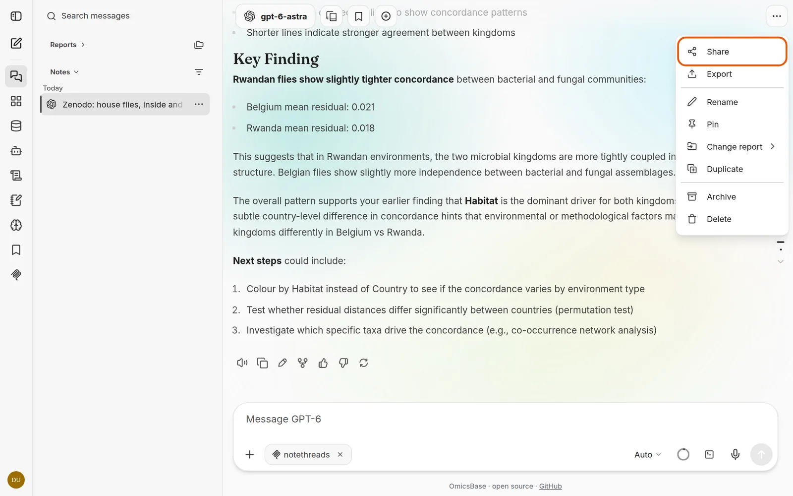
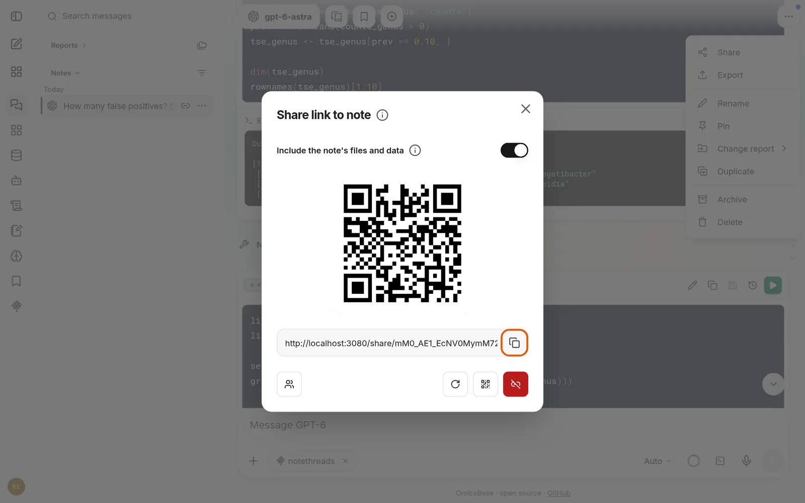
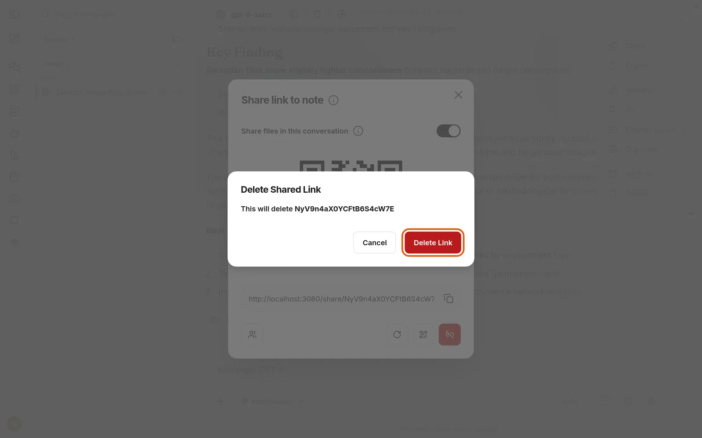

You can share a note with a link. Anyone who has the link can read the note, with its R code, output and figures. They can also continue it in their account. You choose whether their copy includes the note's data.

## Share a note {#share-a-note}

1. Open the note you want to share.
2. Click the **...** button at the top of the note. Its name is **Chat options**.
   A menu opens.
3. Click **Share**.
   A box opens with the title **Share link to note**.

   <!-- screenshot: share-menu — the open Chat options menu with Share highlighted -->
   {.screenshot fig-alt="The open Chat options menu with Share highlighted."}

4. Choose whether to share the note's data. The switch **Include the note's files and data** is on at first. When it is on, viewers see the note's files, and people who continue the note get a copy of its data, so the code runs for them. When it is off, they get the code and results, but not the files you uploaded (see [What is copied](#what-is-copied)).
5. Click **Create a shared link**.
   The link appears, with a QR code.
6. Click **Copy link**.
   The button changes to **Copied**. Paste the link into an email or a message to the people you want to share with.

   <!-- screenshot: share-dialog — the "Share link to note" box after the link is made, with the link, the QR code and the Copy link button; highlight Copy link -->
   {.screenshot fig-alt="The 'Share link to note' box after the link is made, with the link, the QR code and the Copy link button."}

After you share, a small dot on the **...** button shows that the note has a link.

::: {.callout-important}
Anyone who gets the link can open it, so share only what anyone may see. Viewers do not see your name.
:::

## What a viewer sees {#what-viewers-see}

A viewer opens the link in a web browser. They see the note as it was when you made or last updated the link:

- your questions and the agent's answers,
- every R cell with its code, status, output, tables and figures,
- the files and images in the note, if **Include the note's files and data** was on.

A viewer can copy the code but cannot change or run the cells.

Messages you add to the note after sharing stay private until you [update the link](#update-the-link).

<!-- screenshot: shared-note-view — a shared note opened by a viewer, showing an R cell with its figure and the Continue this note button; highlight the button -->
{.screenshot fig-alt="A shared note opened by a viewer, showing an R cell with its figure and the Continue this note button."}

## Continue someone else's note {#continue-a-shared-note}

1. Open the link you were given.
   The shared note opens.
2. Click **Continue this note**.
   If you are not signed in, the sign-in page opens first. After you sign in, you come back to the note.
3. A copy of the note opens in your account.
   It has the messages, the R cells with their output, and the note's files.
4. Type your next question in the message box and press **Enter**.
   The agent carries on from where the note ended.

The copy is yours. It is listed under **Note History** in your sidebar. What you do in it does not change the original note.

## What is copied when someone continues your note {#what-is-copied}

When someone clicks **Continue this note** on your link, what they get depends on the switch **Include the note's files and data**:

- **On:** a copy of everything in the note's folder, including the data files you uploaded and the note's saved R session. They can rerun the code and carry on straight away.
- **Off:** the messages, the R code, the results and the figures, but not the files you uploaded or the saved R session. To rerun the code, they add the data themselves.

To change the choice for a link you already made, open **Share** again, flip the switch and click **Update link**.

## Update the link {#update-the-link}

The link shows the note as it was when you made it. To show newer messages:

1. Open the note and click **...** (**Chat options**), then **Share**.
   The **Share link to note** box opens with your link.
2. Click the button **Update link**.
   A box asks **Update shared link?**
3. Click **Update link** again.
   The link stays the same and now shows the latest messages.

## Stop sharing {#stop-sharing}

1. Open the note and click **...** (**Chat options**), then **Share**.
   The **Share link to note** box opens.
2. Click the button **Delete Link**.
   A box with the title **Delete Shared Link** asks you to confirm.
3. Click **Delete Link**.
   The link stops working. Anyone who opens it sees **Shared link not found**.

   <!-- screenshot: delete-link — the Delete Shared Link confirmation box; highlight Delete Link -->
   {.screenshot fig-alt="The Delete Shared Link confirmation box."}

Copies that people already made with **Continue this note** stay in their accounts.

### See all your shared notes {#all-shared-notes}

1. Click your name in the sidebar.
   A menu opens.
2. Click **Settings**, then **Data & Privacy**.
3. Look at **Shared notes**.
   You see every note you have shared. You can delete links from here too.
