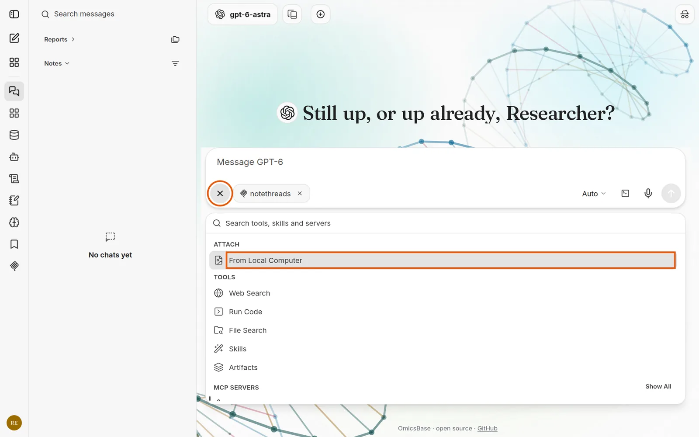
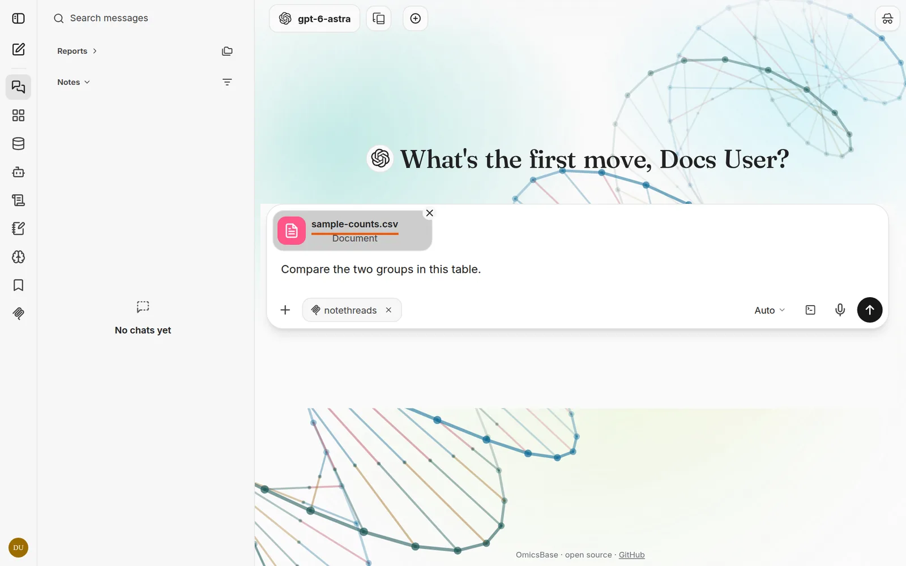
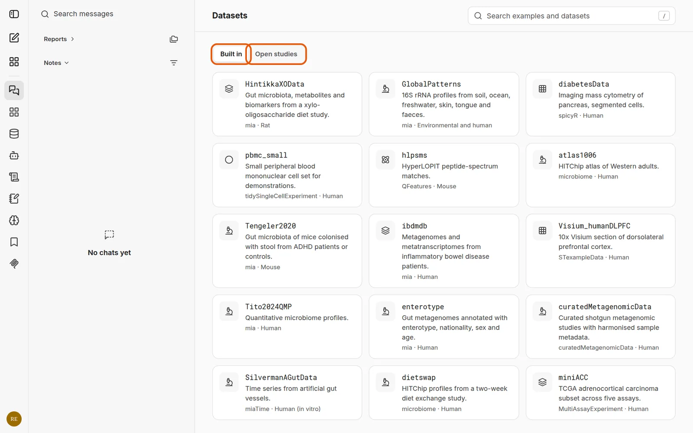

A note can work on files you upload or on public data that OmicsBase loads for you.

## Upload a file to a note {#upload}

1. Open the note you want to use, or start one with **New note** in the sidebar.
2. Click the **+** button in the message box. Its name is **Attach and tools**.
   A list opens. The upload choices are at the top, under **Attach**.

   <!-- screenshot: attach-menu — the open "Attach and tools" list with the Attach section at the top; highlight the + button and "From Local Computer" -->
   {.screenshot fig-alt="The open 'Attach and tools' list with the Attach section at the top."}

3. Click **From Local Computer**.
   Your computer's file window opens.
4. Pick your file and click **Open**.
   The file appears in the message box, ready to send.
5. Type what the file is and what you want, for example: `This is my sample metadata. Show me the columns and how many samples are in each group.`
6. Press **Enter**.
   The agent reads the file from the note's folder with R and shows you what is in it.

   <!-- screenshot: file-in-tray — a file waiting in the message box with a question typed; highlight the file -->
   {.screenshot fig-alt="A file waiting in the message box with a question typed."}

You can also drag a file from your computer and drop it on the note.

::: {.callout-tip}
Tell the agent what each file holds: which file is the count table, which is the sample information, which column has the groups. It checks that samples match across files before it runs any test.
:::

## Which files you can upload {#file-types}

| What | Examples |
| --- | --- |
| Tables and other text files | `.csv`, `.tsv`, `.txt` |
| R data files | `.rds` |
| Other data formats | Parquet, HDF5, JSON, XML |
| Archives | `.zip`, `.tar`, `.gz` |
| Documents and pictures | PDF, PNG, JPEG |

Many other data files work too.

**Limits:** up to 10 files in one message, and up to 512 MB for one file or for all files in one message together.

If OmicsBase says **Unsupported file type for endpoint:**, upload the file in a `.zip` archive. If it says **File size limit exceeded for endpoint:**, upload a smaller file, for example by filtering the data on your computer first or splitting it into parts.

::: {.callout-note}
Notes work in R. Raw sequencing reads (FASTQ files) are processed in [Reports on Roihu](reports-roihu.qmd#bio-tools), then the results come back to a note.
:::

## Where your files are kept {#where-files-live}

Each note has its own folder on the OmicsBase server. Your uploads go into a folder inside it called `data`. A file named `samples.csv` is found at `data/samples.csv`. The agent uses that path in its R code.

Files that the R code writes, such as tables and figures, are saved in the note's folder too.

To see everything in the folder, ask the agent: `Which files are in this note?`

Each note works with the files in its own folder. To use a file in another note, upload it there too.

When someone continues a note you shared, they get a copy of the note's folder. See [Share a note](share.qmd#what-is-copied).

## What the model sees of your files {#what-the-model-sees}

The model you picked in the [model list](models.qmd) runs at the company that provides it.

- **Data files** stay on the OmicsBase server. These are tables, R data files, archives, sequence files and other data formats, and most files larger than 50 KB. The model is told only the file's name and where it is, such as `data/samples.csv`.
- **Pictures and short documents**, such as an image or a short text file, may be sent to the model so it can read them.
- **What R prints** is sent to the model. When a cell shows the first rows of your table, the model sees those rows too. That is how it knows what your data looks like.

## Start from public data {#public-data}

To try OmicsBase without your data, start from these built-in public sources:

| Source | What it has |
| --- | --- |
| Bioconductor data packages | Example datasets that come installed with R packages, for microbiome, single-cell, spatial, proteomics and multi-omics data |
| curatedMetagenomicData | Microbiome profiles from published studies, ready to load |
| MGnify | Public microbiome studies, which you can search by biome |
| Zenodo | Open data records, such as abundance tables from published studies |

### Pick a dataset from the list {#pick-a-dataset}

1. Click **Datasets** in the sidebar.
   The Datasets page opens with two tabs: **Built in** and **Open studies**.

   <!-- screenshot: datasets-page — the Datasets page with the Built in and Open studies tabs; highlight both tabs -->
   {.screenshot fig-alt="The Datasets page with the Built in and Open studies tabs."}

2. Choose a tab:
   - **Built in** shows datasets that are already installed. Each card shows the dataset's name, what it is, the R package it comes from and the species.
   - **Open studies** shows public microbiome studies. Click **MGnify** or **Zenodo** to choose where they come from. For MGnify you can also choose a biome, such as **Human gut** or **Soil**.
3. To find something, type in the search box at the top.
4. Click a card.
   A new note opens with a first question already written for you, for example `Load GlobalPatterns from mia and give me an overview of what it contains.`
5. Press **Enter** to send it.
   The agent loads the data and describes it.

### Ask for public data by name {#ask-by-name}

In a note, name the source and what you want, for example:

- `Which example datasets does the scRNAseq package have?`
- `Load a study from curatedMetagenomicData and show the sample information.`
- `Use MGnifyR to look up MGnify study <study accession> and show me the sample metadata first.`
- `Download the data files from Zenodo record <record number> and import the abundance table.`

Replace the parts in angle brackets, such as `<study accession>`, with the real study number.

The agent has a tool that lists the datasets inside any installed R package and uses it to find example data. Data from MGnify and Zenodo is downloaded while the note runs.

::: {.callout-tip}
Whole MGnify studies can take longer to download than a cell is allowed to run ([10 minutes](cells.qmd#time-limit)). Ask for the sample information first, then for a small set of samples.
:::
